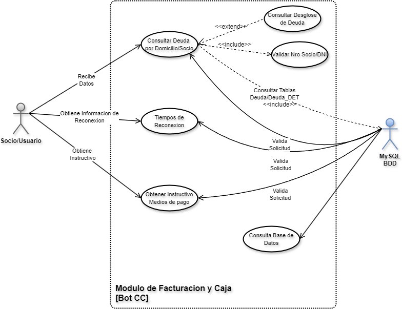
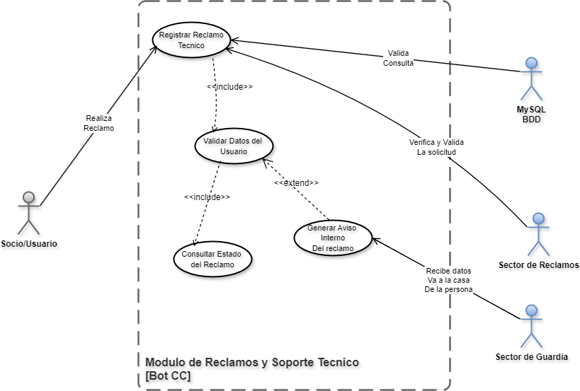
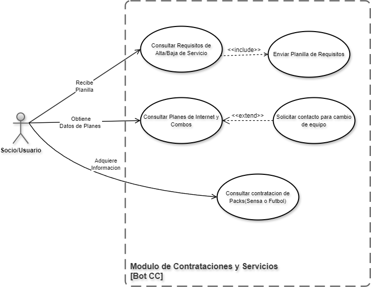
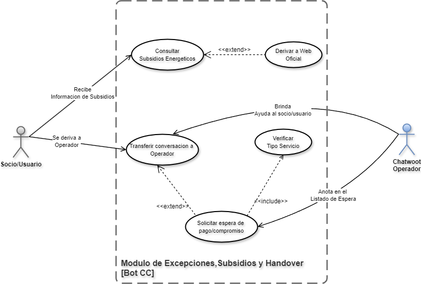

## 📐 Diagramas de Casos de Uso

> **Diseño de agosto de 2026.** Corresponden al diseño inicial y no se actualizaron después de la reestructuración de octubre. Los casos de uso vigentes están en [02 · Especificación funcional](../../docs/02_especificacion_funcional_y_casos.md#-2-matriz-de-casos-de-uso), y las diferencias con este diseño, en la [sección 5](../../docs/02_especificacion_funcional_y_casos.md#-5-diferencias-con-el-diseño-original) de ese documento.

Cada imagen tiene al lado su fuente `.drawio`, que se abre en [draw.io](https://app.diagrams.net/).

### Módulo general

### Módulo Caja

### Módulo Trámites y Reclamos

### Contratación de servicios

### Excepciones

