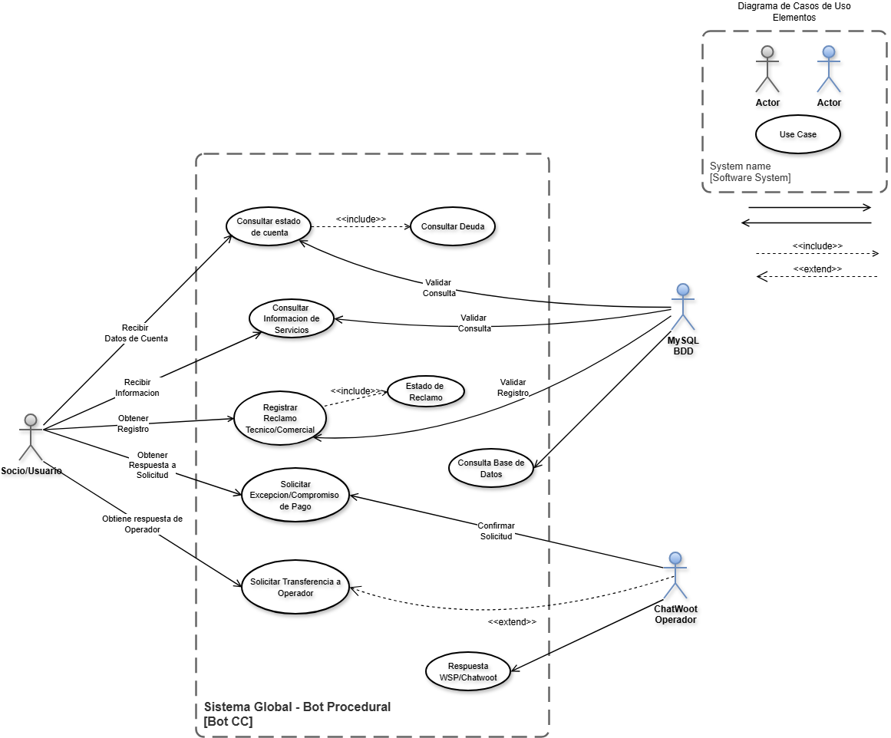

## 📐 Diagramas de Casos de Uso

> **Diseño de agosto de 2026.** Estos diagramas corresponden al diseño inicial y no se actualizaron después de la reestructuración de octubre. Los casos de uso vigentes están en [02 · Especificación funcional](../../docs/02_especificacion_funcional_y_casos.md#-2-matriz-de-casos-de-uso), y las diferencias con este diseño, en la [sección 5](../../docs/02_especificacion_funcional_y_casos.md#-5-diferencias-con-el-diseño-original) de ese documento.

### Módulo General

### Módulos pendientes de subir

Los fuentes están en la carpeta local `Diagramas Draw.io/TypeBot/1. Diagramas de Casos de Uso/`:

| Módulo | Fuente | Imagen |
|---|---|---|
| Caja | `Diagrama_Modulo_Caja.drawio` | `Diagrama_Modulo_Caja.png` |
| Trámites y Reclamos | `Diagrama_Modulo_Reclamos.drawio` | `Diagrama_Modulo_Reclamos.png` |
| Contratación de Servicios | `Diagrama_contrataciones_servicios.drawio` | `Diagrama_contrataciones_servicios.png` |
| Excepciones | `Diagrama_Modulo_excepciones.drawio` | `Diagrama_Modulo_excepciones.png` |
