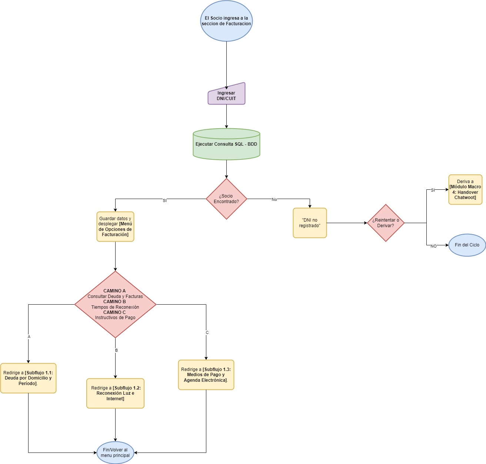
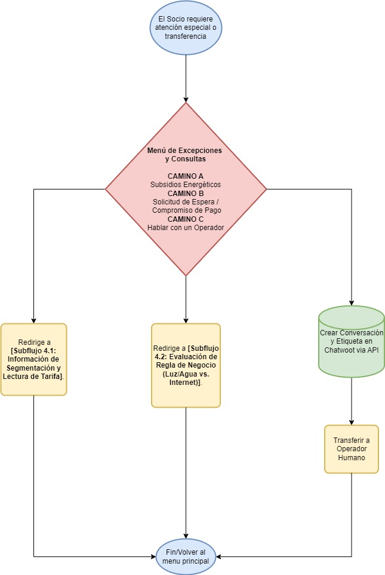

## 🔀 Diagramas de Flujo

> **Diseño de agosto de 2026.** Muestran el recorrido planificado por módulo. El flujo implementado está en los diagramas Mermaid de cada [módulo](../../docs/modulos/) y difiere en algunos puntos: el desglose de deuda se desactivó, la autogestión de WiFi figura como *Próximamente* y la derivación es por widget web en lugar de WhatsApp.

Fuentes: `Modulos_macros.drawio` (flujo por módulo) y `Subflujos_1_Facturación y Cajas.drawio` (subflujos de facturación).

### Módulos

#### Facturación y Caja

#### Reclamos y Soporte Técnico

#### Contratación de servicios y autogestión de WiFi

#### Excepciones, subsidios y Chatwoot

### Subflujos de Facturación y Caja

#### 1.1 Deuda por domicilio y período

#### 1.2 Tiempos de conexión y reconexión

#### 1.3 Instructivos de pago y medios acreditados

