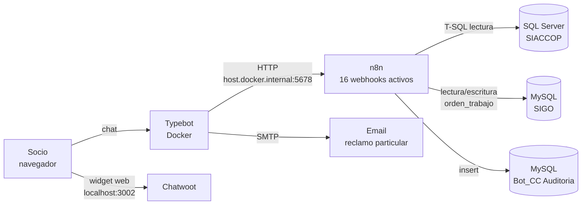

# 1. Arquitectura e inventario de integraciones

Typebot maneja la conversación y no accede a ninguna base de datos. Cada consulta o escritura pasa por un webhook de n8n, que trabaja contra tres bases: SQL Server SIACCOP (padrón, deuda, tarifas), MySQL SIGO (órdenes de trabajo) y MySQL Bot_CC (auditoría). Chatwoot se carga en el navegador del socio para derivar el chat a un operador.

## Diagrama de componentes

## Bases de datos

| Base | Motor | Credencial en n8n | Uso | Acceso |
|---|---|---|---|---|
| SIACCOP | SQL Server | `Microsoft SQL SIACCOP LOCAL` | Padrón (`USUENER`, `USUAGUA`, `USUINTE`), estados (`USUESTADOS`), deuda (`DEUDA`, `DEUDA_DET`), lecturas (`ESTADOS`), catálogo (`ITEMS`, `TARIFAS`, `CATEG_DET`, `USUITEM_I`) | Solo lectura (en lo observado) |
| SIGO | MySQL | `MySQL SIGO Local` | Órdenes de trabajo (`orden_trabajo`, `auxiliar_estado_trabajos`, `auxiliar_cierre_actividades`) | Lectura y **escritura** |
| Bot_CC | MySQL | `MySQL Bot_CC Auditoria` | `auditoria_bot` | Escritura |

> Recomendación: el usuario de SQL Server que usa n8n debería tener solo `SELECT` sobre esas tablas, y el de SIGO solo `SELECT` + `INSERT` sobre `orden_trabajo`. Así, una inyección SQL no puede modificar ni borrar datos.

## Entorno observado en los exports

| Elemento | Valor | Observación |
|---|---|---|
| URL base de n8n | `http://host.docker.internal:5678/webhook/...` | Typebot en Docker llamando al host. Válido solo en el entorno local |
| URL de Chatwoot | `http://localhost:3002/` | La resuelve el navegador del socio: en producción no funciona |
| Autenticación de webhooks | Ninguna | H-03 |
| Credenciales de base | Sufijo `LOCAL` | Bases de desarrollo |

## Inventario de webhooks

| Webhook | Método | Workflow | Llamado desde (Typebot) | Base |
|---|---|---|---|---|
| `identificar_socio` | POST | 1. Validaciones_Socio | Bienvenida y Verificacion | SIACCOP |
| `vincular_socio` | POST | 1. Validaciones_Socio | Validación de usuario | SIACCOP |
| `filtrar_domicilio` | POST | 1. Validaciones_Socio | domicilio_filtro | SIACCOP |
| `deuda_total` | POST | 2. consultar_deuda | HTTP - Deuda Total | SIACCOP |
| `deuda_servicio` | POST | 2. consultar_deuda | Detalle. | SIACCOP |
| `generar_link_factura` | POST | 2. consultar_deuda | HTTP - ComprobantesCuecca | SIACCOP |
| `consumo_ener_agua` | POST | 2. consultar_deuda | HTTP - Consumos | SIACCOP |
| `items_internet` | POST | 3. Modulo_Internet | http_items_internet | SIACCOP |
| `consultar_pack_internet` | GET | 3. Modulo_Internet | http_consulta_packs | SIACCOP |
| `suscripciones` | GET | 3. Modulo_Internet | http_consulta_suscripciones | SIACCOP |
| `consultar_tarifas` | POST | 3. Modulo_Internet | HTTP_Busqueda_Tarifas | SIACCOP |
| `usuario_activo` | POST | 4. Modulo_Reclamos | HTTP - Verificacion Estado Usuario * | SIACCOP |
| `limite_reclamos` | POST | 4. Modulo_Reclamos | HTTP_Reclamo_Limite_* | SIGO |
| `registrar_reclamo` | POST | 4. Modulo_Reclamos | HTTP Reclamo* | SIGO |
| `estado_reclamo` | POST | 4. Modulo_Reclamos | HTTP - Estado_Reclamo Activo | SIGO |
| `auditoria` | POST | 5. Modulo_Auditoria | HTTP  - Auditoria (evento *reply*) | Bot_CC |

**Webhooks expuestos que Typebot no usa** (H-25):

| Webhook | Workflow | Estado |
|---|---|---|
| `desglose_deuda` | 2. consultar_deuda | Activo, marcado "REMOVIDO" en el sticky note |
| `tarifas_comerciales` | 3. Modulo_Internet | Activo, sin llamadas |
| `vincular_socio_reclamo` | 4. Modulo_Reclamos | Desactivado |

## Convenciones de integración

- **Respuestas:** casi todos los nodos *Respond to Webhook* devuelven el primer ítem como objeto, y Typebot lo lee como `data.campo`. Las excepciones devuelven un array (`identificar_socio`, `vincular_socio`): ahí Typebot debe leer `data[0].campo`.
- **Domicilio:** Typebot envía la etiqueta del botón (`CALLE 123 (ENERGIA, AGUA)`) y n8n la limpia en `Limpiar_Domicilio` cortando en `(`.
- **Body:** Typebot arma los JSON reemplazando `{{variables}}` en texto, sin escapar caracteres (H-11).

## Eventos de Typebot

| Evento | Destino | Función |
|---|---|---|
| `start` | Grupo `Inicio` | Guarda el ID del resultado en `audit_result_id` y entra a la bienvenida |
| `reply` | Grupo `HTTP  - Auditoria` | Envía cada respuesta a `auditoria` y vuelve al flujo (`Return`) |

## Mapa de módulos (menú principal)

| Opción del menú | Módulo | Documento |
|---|---|---|
| Consultar deuda total | Deuda | [02](modulos/02-deuda-facturacion-consumos.md) |
| Descargar mi factura | Facturación | [02](modulos/02-deuda-facturacion-consumos.md) |
| Hacer un reclamo | Reclamos | [04](modulos/04-reclamos.md) |
| Ver mis suministros | Deuda por suministro, consumos, tarifa | [02](modulos/02-deuda-facturacion-consumos.md), [03](modulos/03-internet-tarifas.md) |
| Declarar pagos / Gestión de mi Internet | Próximamente, sin lógica | — |
| Hablar con un operario | Derivación a Chatwoot | Pendiente |
| Trámites, subsidios y tarifas | Informativo + tarifa | [03](modulos/03-internet-tarifas.md) |
| Planes de Internet y packs | Internet | [03](modulos/03-internet-tarifas.md) |
| Alta de servicio / Información general / Métodos de pago / Horarios | Textos y enlaces fijos | — |
| Cerrar Sesión | Valoración y cierre | — |
