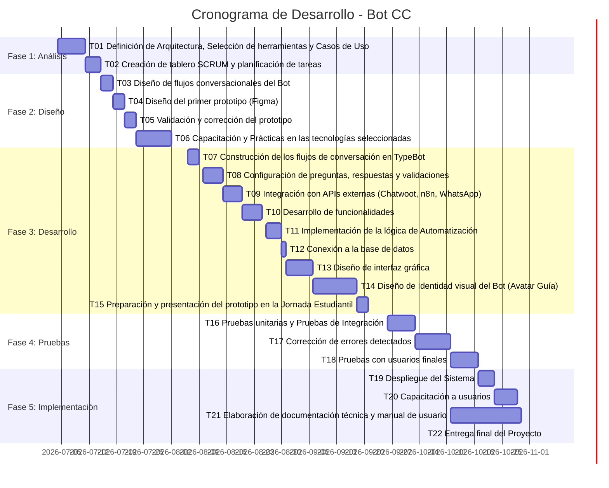

# 📋 Requerimientos y Planificación de Proyecto: Bot CC (CUECCA)

Este documento reúne la pila de productos, los requerimientos funcionales y no funcionales, y el cronograma del proyecto **Bot CC**, con el estado de cada ítem según la implementación al 29-10-2026.

> **Actualización 03-11-2026:** estados revisados según las correcciones verificadas. **Actualización 30-10-2026.** Se agregó una columna de estado con evidencia en cada tabla, y los requerimientos que surgieron durante el desarrollo (RF11 a RF24, RNF06 a RNF08). Los ítems marcados *a confirmar* no se pueden verificar desde los exports.

**Estados:** ✅ Cumplido · 🟡 Parcial · ⏳ Pendiente · ❌ No cumplido · ❔ A confirmar

---

## 🎯 1. Pila de Productos (Product Backlog)

| ID | Funcionalidad | Prioridad | Estado | Evidencia / observación |
| :---: | :--- | :---: | :---: | :--- |
| **01** | Mostrar en pantalla las secciones de temas que puede responder el Bot | **Alta** | ✅ | `Menu Principal`: 14 opciones, filtradas según el tipo de usuario |
| **02** | Gestión de datos y conexión a la base de datos | **Alta** | ✅ | SQL Server SIACCOP + MySQL SIGO y Bot_CC, vía n8n |
| **03** | Panel de Usuario | **Alta** | ✅ | Menú de socio validado (`usuario_valido = 1`) |
| **04** | Integración de la base de datos de CUECCA | **Alta** | ✅ | Lectura directa de SIACCOP; no hizo falta carga ni migración |
| **05** | Panel de Administrador | **Alta** | ❔ | No hay panel propio. La administración se hace desde los editores de Typebot y n8n y la bandeja de Chatwoot |
| **06** | Construcción del árbol de posibilidades (camino procedural delimitado) | **Alta** | ✅ | 171 grupos en Typebot (v2.3), sin entradas libres fuera de los formularios |
| **07** | Historial de conversación | **Media** | ✅ | Módulo 5: tabla `auditoria_bot` |
| **08** | Diseño de la experiencia conversacional | **Media** | ✅ | **BOT CC v2.3** (03-11-2026): menús en tarjeta con color por área, burbujas y fondo con la identidad de CUECCA, avatares propios y mensajes de error y confirmación en reclamos e internet ([tema visual](05_tema_visual.md)) |
| **09** | Cambio de temática entre secciones | **Media** | ✅ | Cada módulo ofrece volver al menú o a la sección anterior |
| **10** | Derivación del usuario a una persona (Chatwoot) | **Media** | 🟡 | Funciona en el widget web, con etiqueta por motivo, atributos y celular del socio ([módulo 6](modulos/06-derivacion-chatwoot.md)). WhatsApp pendiente |
| **11** | Diseño e interacción del personaje (avatar guía) | **Baja** | 🟡 | Avatar propio del bot y del socio (v3). Las expresiones por estado (normal, contento, procesando) se descartaron (H-32) |

---

## 📌 2. Especificación de Requerimientos

### ⚙️ Requerimientos Funcionales (RF)

#### Definidos al inicio del proyecto

| ID | Requerimiento | Estado | Evidencia / observación |
| :---: | :--- | :---: | :--- |
| **RF01** | El sistema deberá permitir al usuario realizar consultas mediante un chat interactivo | ✅ | Typebot web |
| **RF02** | El sistema deberá vincularse con Chatwoot (WhatsApp de la empresa) para responder consultas y gestionar derivaciones | 🟡 | Derivación por widget web. El canal WhatsApp está pendiente ([arquitectura objetivo](04_arquitectura_e_integraciones.md#-2-arquitectura-objetivo-whatsapp)) |
| **RF03** | El sistema debe vincularse directamente con la base de datos de la Empresa | ✅ | SIACCOP y SIGO |
| **RF04** | El sistema debe ser neutral en el tono y tipo de respuestas que emite | ✅ | Textos fijos y revisados |
| **RF05** | El sistema deberá clasificar las consultas por categorías mediante rutas predefinidas | ✅ | Menú por módulos y motivos tipificados |
| **RF06** | El sistema no debe perder el hilo de la conversación y debe ser reutilizable en múltiples sesiones | 🟡 | Dentro de una sesión se cumple. Entre sesiones el socio vuelve a validarse; el reconocimiento por celular (WhatsApp) lo resolvería |
| **RF07** | El sistema debe ser estrictamente procedural | ✅ | Sin IA generativa: solo botones, condiciones y consultas |
| **RF08** | El sistema debe ser concreto en su alcance e impedir consultas fuera de sus capacidades | ✅ | El texto libre solo se acepta en formularios puntuales (datos, comentario del reclamo) |
| **RF09** | El sistema deberá sustentarse en la base de datos para responder cada consulta | ✅ | Deuda, consumos, tarifas, planes y reclamos salen de la base. La información institucional son textos fijos (ver [manual](03_manual_despliegue_y_mantenimiento.md#-5-contenido-estático-del-bot)) |
| **RF10** | El sistema debe incluir gestión de roles para su uso y administración | 🟡 | Dos roles en el bot: socio (`1`) e invitado (`0`). No hay roles de administración propios |

#### Incorporados durante el desarrollo

| ID | Requerimiento | Estado | Documento |
| :---: | :--- | :---: | :--- |
| **RF11** | Identificar al socio por N° de cuenta y DNI contra el padrón activo | ✅ | [Módulo 1](modulos/01-validacion-socio.md) |
| **RF12** | Permitir el acceso como invitado, con un menú reducido | ✅ | [Módulo 1](modulos/01-validacion-socio.md) |
| **RF13** | Reconocer al socio por su número de celular | ⏳ | Depende del canal WhatsApp. H-02, H-04 y H-05 resueltos; falta H-06 (sesión incompleta) |
| **RF14** | Seleccionar el domicilio de trabajo; con más de 8 domicilios, buscarlo por texto + N° de usuario | ✅ | [Módulo 1.2](modulos/01-validacion-socio.md#12-selección-de-domicilio) |
| **RF15** | Mostrar la deuda total por período y la deuda por suministro (energía, agua, internet, sepelio, municipalidad) | ✅ | [Módulo 2](modulos/02-deuda-facturacion-consumos.md). Sin año fijo (H-14) y sin doble conteo de sepelio (H-15). Pendiente: prefijo 80 (H-33) |
| **RF16** | Dar acceso a las facturas digitales en el portal de comprobantes con los datos precargados | ✅ | [Módulo 2.4](modulos/02-deuda-facturacion-consumos.md#24-enlace-a-facturas--generar_link_factura) |
| **RF17** | Mostrar los consumos recientes de energía y agua por medidor | ✅ | [Módulo 2.5](modulos/02-deuda-facturacion-consumos.md#25-consumos--consumo_ener_agua) |
| **RF18** | Informar la tarifa asignada al socio | ✅ | Muestra la tarifa de **energía**, por requerimiento del área ([Módulo 3.5](modulos/03-internet-tarifas.md)) |
| **RF19** | Mostrar los planes de internet, packs adicionales y servicios contratados, con precios actualizados desde la base | ✅ | [Módulo 3](modulos/03-internet-tarifas.md) |
| **RF20** | Verificar que el suministro esté activo antes de aceptar un reclamo | ✅ | [Módulo 4.2](modulos/04-reclamos.md#42-estado-del-suministro--usuario_activo) |
| **RF21** | Limitar a un reclamo abierto por socio, domicilio y servicio | ✅ | [Módulo 4.3](modulos/04-reclamos.md#43-límite-de-reclamos--limite_reclamos) |
| **RF22** | Registrar el reclamo técnico como orden de trabajo en SIGO | ✅ | [Módulo 4.4](modulos/04-reclamos.md#44-registro--registrar_reclamo). El socio recibe el N° de OT; si el alta falla, se le avisa (H-12) |
| **RF23** | Consultar el estado de los reclamos activos y cerrados | ✅ | Muestra el estado del reclamo elegido (H-17) |
| **RF24** | Respetar los horarios de atención en la derivación a operador y en los reclamos de internet | ✅ | Grupos `horario_laboral`. Ver inconsistencia de horarios en el [manual](03_manual_despliegue_y_mantenimiento.md#-5-contenido-estático-del-bot) |

### 🛡️ Requerimientos No Funcionales (RNF)

| ID | Requerimiento | Estado | Evidencia / observación |
| :---: | :--- | :---: | :--- |
| **RNF01** | El tiempo de respuesta del Bot no debe superar los 5 segundos por interacción | ❔ | Sin medición. Se puede medir con la duración de las ejecuciones en n8n → *Executions*. El caso más pesado es `deuda_servicio` (5 consultas en paralelo) |
| **RNF02** | El bot debe conservar los datos temporales de la consulta si se pierde la conexión | ❔ | Depende de la persistencia de sesión de Typebot; no está probado |
| **RNF03** | El sistema debe garantizar alta disponibilidad (24/7) | ❌ | Hoy corre en un entorno local (`localhost`, credenciales `LOCAL`). La derivación a operador respeta horarios, por diseño |
| **RNF04** | La base de datos podrá actualizarse sin modificar el código del Bot | 🟡 | Se cumple para montos, consumos, precios y estados. No se cumple donde hay valores fijos en el código: nombres de productos y filtros de packs (H-23), códigos de tarifa e IVA del 21 % |
| **RNF05** | El sistema debe ser compatible con dispositivos móviles | ❔ | Typebot web es responsivo; falta registrar las pruebas en dispositivos |
| **RNF06** | Los servicios de integración (webhooks) solo deben ser accesibles por el bot | ❔ | Depende del despliegue. Los webhooks no piden autenticación, así que la restricción tiene que darla la red: n8n accesible solo desde Typebot. Si se expone, agregar *Header Auth* (H-03) |
| **RNF07** | Los datos ingresados por el usuario no deben poder alterar las consultas a la base | ✅ | Validación y escape en todos los webhooks de n8n y `JSON.stringify` en Typebot (H-01, H-11). Verificado el 03-11-2026 |
| **RNF08** | Los datos personales deben guardarse con retención definida y acceso restringido | ❌ | Auditoría y *Results* de Typebot sin política de retención (H-24, decisión pendiente) |

---

## 📅 3. Cronograma y Plan de Trabajo (Gantt)

### 3.1 Estado de las tareas al 30-10-2026

Solo se marcan las tareas con evidencia en los archivos del proyecto; el resto queda para completar.

| Tarea | Estado | Evidencia |
| :--- | :---: | :--- |
| T01 a T15 | ❔ | Completar |
| T09 Integración con WhatsApp | ⏳ | El canal WhatsApp no está implementado; Chatwoot y n8n sí |
| T14 Avatar guía | ✅ | Avatares v3 del bot y del socio, incluidos en el tema (v2.3) |
| T15 Jornada Estudiantil | ❔ | Hay videos de demostración de septiembre en `Videos_presentacion/` |
| T16 a T18 Pruebas | ❔ | Completar. Los casos de prueba del [manual](03_manual_despliegue_y_mantenimiento.md#-4-matriz-de-pruebas-y-aceptación) sirven para registrar los resultados |
| T19 Despliegue | ⏳ | Los exports del 29-10 todavía apuntan a `localhost` con credenciales `LOCAL` |
| T21 Documentación | 🟡 | Módulos 0 a 6, arquitectura, manual, tema visual y hallazgos actualizados al 03-11-2026. Falta subir los exports limpios |
| T22 Entrega final | ⏳ | 05-11-2026 |
