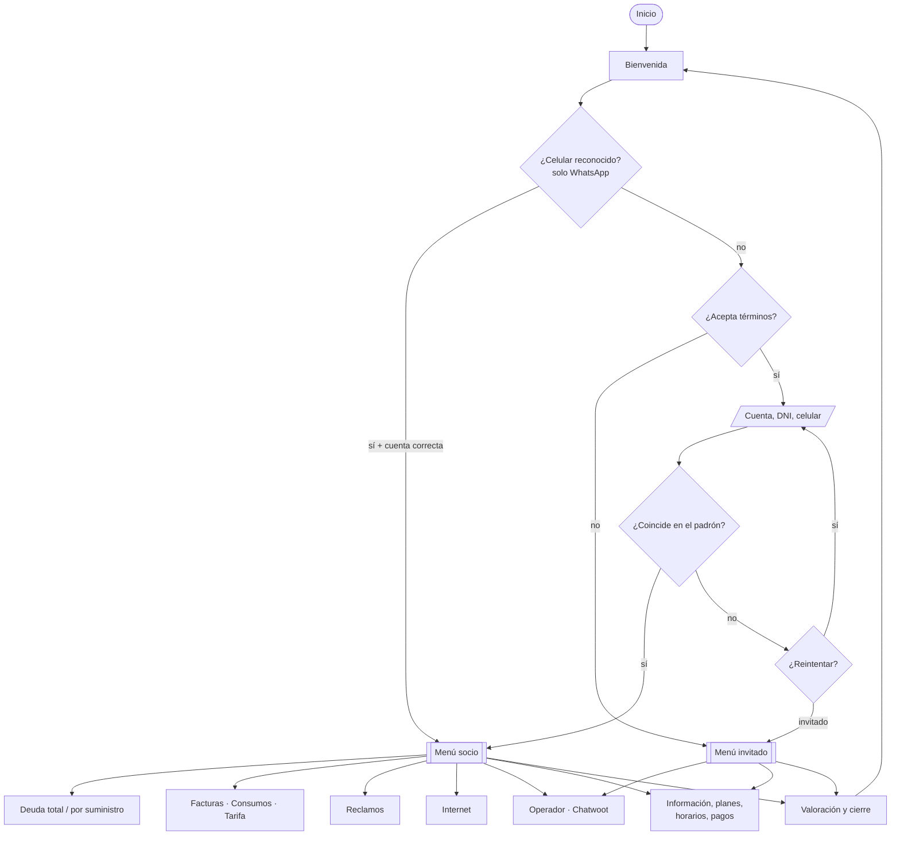

# ⚙️ Especificación Funcional y Casos de Uso: Bot CC (CUECCA)

Este documento define los casos de uso de **Bot CC**, sus reglas de negocio y el flujo general de la conversación. El detalle técnico de cada caso (webhooks, consultas SQL, variables) está en los documentos de [`modulos/`](modulos/).

> **Actualización 03-11-2026:** derivación con etiquetas (H-28). **Actualización 30-10-2026.** Se reescribió a partir de la implementación. El diseño original organizaba el bot en dos sectores (Caja y Trámites/Reclamos) con derivación etiquetada a Chatwoot; la implementación usa un menú único con visibilidad por rol. La sección 4 lista las diferencias.

---

## 👥 1. Actores

| Actor | Descripción | Cómo se identifica |
|---|---|---|
| **Socio validado** | Titular que ingresó N° de cuenta y DNI y fue encontrado en el padrón activo | `usuario_valido = 1` |
| **Invitado** | Persona que no aceptó los términos, no pudo validarse o eligió seguir sin validar | `usuario_valido = 0` |
| **Operador** | Personal de CUECCA que atiende en Chatwoot | — |
| **Guardia técnica** | Personal que recibe las órdenes de trabajo en SIGO | — |

## 📌 2. Matriz de casos de uso

| ID | Módulo | Caso de uso | Actor | Descripción | Doc. | RF |
| :---: | :--- | :--- | :---: | :--- | :---: | :---: |
| **CU01** | Validación | Identificarse como socio | Socio | Acepta los términos, ingresa N° de cuenta, DNI y celular. Si coinciden con un registro activo, accede al menú completo; si no, puede reintentar o seguir como invitado | [1](modulos/01-validacion-socio.md) | RF11 |
| **CU02** | Validación | Ingresar como invitado | Invitado | Accede a un menú reducido: información, planes, horarios, métodos de pago y operador | [1](modulos/01-validacion-socio.md) | RF12 |
| **CU03** | Validación | Elegir domicilio | Socio | Elige un domicilio de la lista; con más de 8, lo busca por texto y N° de usuario | [1.2](modulos/01-validacion-socio.md#12-selección-de-domicilio) | RF14 |
| **CU04** | Deuda | Consultar deuda total | Socio | Ve toda su deuda pendiente agrupada por período, con vencimiento y estado (vencido / a vencer) | [2.2](modulos/02-deuda-facturacion-consumos.md) | RF15 |
| **CU05** | Deuda | Consultar deuda por suministro | Socio | Elige un domicilio y ve la deuda de energía, agua, internet, sepelio y municipalidad | [2.3](modulos/02-deuda-facturacion-consumos.md) | RF15 |
| **CU06** | Facturación | Acceder a facturas digitales | Socio / Invitado | El socio entra al portal de comprobantes con sus datos precargados; el invitado entra al portal sin datos | [2.4](modulos/02-deuda-facturacion-consumos.md#24-enlace-a-facturas--generar_link_factura) | RF16 |
| **CU07** | Suministros | Consultar consumos | Socio | Ve las últimas lecturas de energía (kWh) y agua (m³) de cada medidor | [2.5](modulos/02-deuda-facturacion-consumos.md#25-consumos--consumo_ener_agua) | RF17 |
| **CU08** | Tarifas | Consultar tarifa y subsidio | Socio | Ve la tarifa de energía asignada | [3.5](modulos/03-internet-tarifas.md) | RF18 |
| **CU09** | Internet | Consultar servicios contratados | Socio | Ve su plan de internet y los packs que tiene contratados | [3.2](modulos/03-internet-tarifas.md) | RF19 |
| **CU10** | Internet | Consultar planes y packs | Socio / Invitado | Ve los planes de internet + TV y los packs adicionales, con precio final | [3.3](modulos/03-internet-tarifas.md) | RF19 |
| **CU11** | Reclamos | Registrar reclamo técnico | Socio | Elige servicio y motivo. El bot verifica que el suministro esté activo y que no haya otro reclamo abierto, pide comentario y domicilio y crea la OT en SIGO | [4](modulos/04-reclamos.md) | RF20–RF22 |
| **CU12** | Reclamos | Registrar reclamo particular | Socio | Para motivos no tipificados: el bot envía un email al área de trámites con los datos del socio | [4.4](modulos/04-reclamos.md#44-registro--registrar_reclamo) | RF22 |
| **CU13** | Reclamos | Consultar estado de reclamos | Socio | Lista sus reclamos activos o cerrados y muestra el detalle del que elige | [4.5](modulos/04-reclamos.md) | RF23 |
| **CU14** | Derivación | Hablar con un operador | Socio / Invitado | Elige el motivo y se abre Chatwoot. Fuera de horario, puede dejar un mensaje. El invitado debe dar nombre y DNI | [6](modulos/06-derivacion-chatwoot.md) | RF02, RF24 |
| **CU15** | Información | Consultar información institucional | Socio / Invitado | Horarios, guardias, métodos de pago, requisitos de alta, tiempos de reconexión y enlaces a OCEBA y a organismos oficiales | [Manual §5](03_manual_despliegue_y_mantenimiento.md#-5-contenido-estático-del-bot) | RF09 |
| **CU16** | Cierre | Valorar la experiencia y cerrar sesión | Socio / Invitado | Deja una valoración y vuelve al inicio | — | — |
| **CU17** | Auditoría | Registrar la interacción | Sistema | Cada respuesta del usuario se guarda en `auditoria_bot` | [5](modulos/05-auditoria.md) | Backlog 07 |

### Opciones del menú según el actor

| Opción | Socio | Invitado |
|---|:---:|:---:|
| Consultar deuda total · Descargar mi factura (con datos) · Hacer un reclamo · Ver mis suministros | ✅ | — |
| Declarar pagos · Gestión de mi Internet (*próximamente*) | ✅ | — |
| Hablar con un operario · Trámites, subsidios y tarifas · Planes de Internet y packs · Alta de servicio · Información general · Métodos de pago · Horarios | ✅ | ✅ |
| Descargar mi factura (sin datos, el portal los pide) | — | ✅ |

## 📏 3. Reglas de negocio

| ID | Regla | Dónde se aplica |
|---|---|---|
| **RN01** | Un socio se valida solo si el N° de cuenta y el DNI coinciden con un registro **activo** (`Activo = 1`) en energía, agua o internet | `vincular_socio` |
| **RN02** | Con más de 8 domicilios, no se muestran botones: se pide búsqueda por texto + N° de usuario | Typebot `valida_cantidad_domicilios` |
| **RN03** | La deuda pendiente es `Total <> Imputado`; el importe es `Total - Imputado` (sepelio: subtotal del ítem 101) | `deuda_total`, `deuda_servicio` |
| **RN04** | Un ítem está *vencido* si su fecha de vencimiento es anterior al momento de la consulta | Nodos Code de deuda |
| **RN05** | Solo se aceptan reclamos de suministros con `Activo = 1` y `CodEstado = 2` | `usuario_activo` |
| **RN06** | Un socio no puede tener más de un reclamo abierto por domicilio y tipo de servicio | `limite_reclamos` |
| **RN07** | Los reclamos de internet fuera de horario (L-V 8 a 19 h, sáb. 8 a 12 h) se aceptan, pero se informa el teléfono de la guardia | Typebot `horario_laboral` |
| **RN08** | El operador atiende L-V de 8 a 12 h y de 16 a 20 h, y los sábados de 8 a 12 h. Fuera de ese horario, el socio puede dejar un mensaje | Typebot `horario_laboral` (derivación) |
| **RN09** | Escribir "cancelar" en el comentario o en el domicilio de un reclamo vuelve al menú sin registrar nada | Typebot `¿Reclamo…cancelado?` |
| **RN10** | Los precios de planes y packs se calculan como `Formula × 1,21` (IVA 21 %) | `consultar_pack_internet`, `suscripciones` |
| **RN11** | El bot es informativo: no recibe pagos ni comprobantes. Las transferencias se informan por email a `tramites@cuecca.com.ar` | Texto `Metodos de pago` |
| **RN12** | La derivación a Chatwoot asigna una etiqueta según el motivo elegido; fuera de horario, `fuera_de_horario` | Typebot, bloque Code de Chatwoot |
| **RN13** | El reclamo se registra con el medidor del domicilio elegido | `registrar_reclamo` (`Medidor_por_domicilio`) |

## 🔀 4. Flujo general

## 🔄 5. Diferencias con el diseño original

| Diseño original | Implementación | Comentario |
|---|---|---|
| Menú con dos sectores: Caja y Trámites/Reclamos | Menú único de 14 opciones, con visibilidad por rol | — |
| Validación por DNI **o** N° de socio en cada consulta | Validación única al inicio, por N° de cuenta **y** DNI | Más segura: dos datos en lugar de uno |
| Enlace de pago en la consulta de deuda | Sin enlace de pago; métodos de pago informativos | Coincide con la política del manual (el bot no cobra) |
| Comprobante para socios sin deuda | Enlace al portal de comprobantes para todos los socios | — |
| Requisitos de alta, baja y cambio de titularidad por servicio | Requisitos de alta según la condición (propietario, comerciante, inquilino). Cambio de titularidad sin contenido. Sin baja | H-29 |
| Reclamo en `reclamos_temporales` (MySQL) con teléfono | OT en `orden_trabajo` de SIGO, sin teléfono de contacto | La guardia trabaja sobre su sistema existente |
| Derivación urgente a Chatwoot después de cada reclamo | No se deriva; la OT queda en SIGO | — |
| Derivación automática después de fallas repetidas de validación | Reintentos sin límite u opción de invitado | — |
| Etiquetas en Chatwoot (`Caja_Atencion`, etc.) | Implementadas con otros nombres (`caja_atencion`, `tramites_atencion`, `reclamo_tecnico_prioridad`, `planes_contrataciones`, `consulta_general`, `fuera_de_horario`); el motivo viaja como atributo | H-28 ✅ |
| Servicio "Cloacas" separado | Incluido en Agua (motivo "Cañería tapada") | — |
| Canal WhatsApp | Canal web; WhatsApp pendiente | [Arquitectura objetivo](04_arquitectura_e_integraciones.md#-2-arquitectura-objetivo-whatsapp) |
