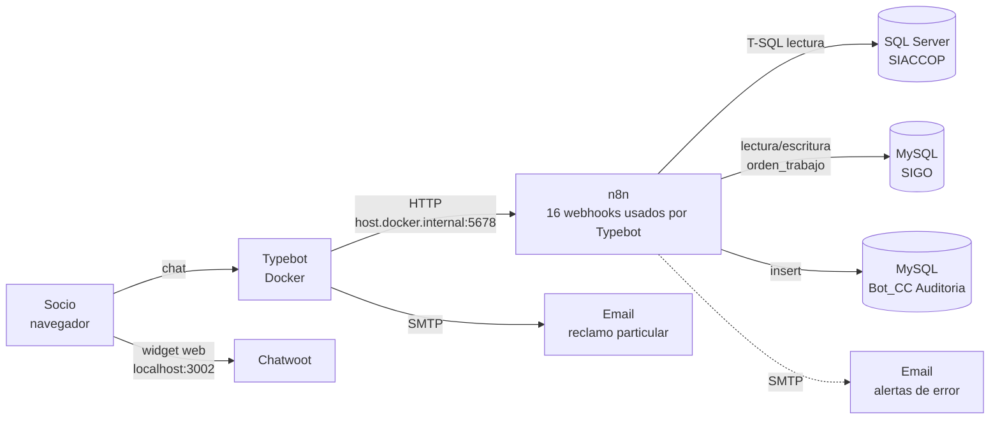
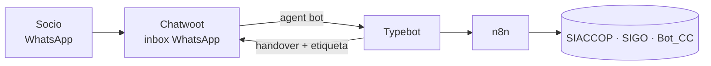

# 🏗️ Arquitectura del Sistema e Integraciones: Bot CC (CUECCA)

Typebot maneja la conversación y no accede a ninguna base de datos. Cada consulta o escritura pasa por un webhook de n8n, que trabaja contra tres bases: SQL Server **SIACCOP** (padrón, deuda, tarifas), MySQL **SIGO** (órdenes de trabajo) y MySQL **Bot_CC** (auditoría). Chatwoot se abre desde Typebot cuando el socio pide hablar con un operador.

> **Actualización 03-11-2026.** Refleja las correcciones verificadas (validación de entradas, Chatwoot con etiquetas, N° de OT) y agrega el workflow `0.Sesion_Usuario`. La versión del 30-10-2026 se reescribió a partir de los exports de Typebot y n8n del 29-10-2026. La versión anterior describía Chatwoot como punto de entrada y un modelo de datos conceptual (`Socios`, `Cuenta_Corriente`, `Reclamos_Temporales`) que no es el que se implementó. Ese diseño se conserva en la sección 2 como **arquitectura objetivo para WhatsApp**.

---

## 🏛️ 1. Arquitectura actual (canal web)

### Componentes y responsabilidades

| Componente | Responsabilidad | Lo que **no** hace |
|---|---|---|
| **Typebot** | Menús, validación de entradas, variables de sesión, reglas de navegación (horarios, visibilidad por rol), redirecciones y email del reclamo particular | No accede a bases de datos |
| **n8n** | Expone los webhooks, **valida las entradas** antes de cada consulta, ejecuta las consultas SQL, aplica reglas de negocio (estado del suministro, límite de reclamos, tipificación de la OT) y da formato a los textos. El workflow 0 avisa por email cualquier error | No decide la navegación |
| **SQL Server SIACCOP** | Fuente de verdad del padrón, la deuda, las lecturas y las tarifas | El bot no escribe en esta base |
| **MySQL SIGO** | Órdenes de trabajo: los reclamos se cargan como OT y se consultan desde acá | — |
| **MySQL Bot_CC** | Historial de cada interacción (auditoría) | — |
| **Chatwoot** | Bandeja de los operadores. Typebot abre el widget web con los datos del socio, una etiqueta por motivo y el motivo como atributo ([módulo 6](modulos/06-derivacion-chatwoot.md)) | No recibe el historial de la conversación con el bot |

## 🎯 2. Arquitectura objetivo (WhatsApp)

Es el diseño original del proyecto y está pendiente de implementar. Chatwoot pasa a ser el punto de entrada: recibe los mensajes de WhatsApp y le delega la conversación a Typebot hasta que haga falta un operador.

Qué cambia respecto del canal web:

| Tema | Estado actual | Necesario para WhatsApp |
|---|---|---|
| Identificación | Cuenta + DNI | Reconocimiento por celular (Camino A, módulo 1). H-02, H-04 y H-05 resueltos; falta H-06 |
| Sesión | La maneja el widget de Typebot | `0.Sesion_Usuario` guarda una sesión por celular ([módulo 0](modulos/00-sesion-usuario.md)). Falta definir qué devuelve al canal (H-34) |
| Handover | Widget web con `baseUrl` `localhost`; etiquetas con el SDK del widget | Handover del agent bot dentro del mismo inbox; las mismas etiquetas, asignadas por API |
| Seguridad | n8n accesible solo en la red local | *Header Auth* en los webhooks si n8n se expone (H-03) |
| Menús | Botones de Typebot | Respetar los límites de WhatsApp: hasta 3 botones por mensaje y hasta 10 opciones por lista. El menú principal tiene 14 opciones |
| Redirecciones | Bloques *Redirect* que abren URLs | En WhatsApp se envían como enlace dentro del texto |
| Script de limpieza de Chatwoot | Borra `localStorage` y cookies del widget | No aplica |

## 🗄️ 3. Bases de datos

| Base | Motor | Credencial en n8n | Tablas usadas | Acceso del bot |
|---|---|---|---|---|
| SIACCOP | SQL Server | `Microsoft SQL SIACCOP LOCAL` | `USUENER`, `USUAGUA`, `USUINTE` (padrón por servicio), `USUESTADOS`, `DEUDA`, `DEUDA_DET`, `ESTADOS` (lecturas), `ITEMS`, `TARIFAS`, `CATEG_DET`, `USUITEM_I` | Solo lectura |
| SIGO | MySQL | `MySQL SIGO Local` | `orden_trabajo`, `auxiliar_estado_trabajos`, `auxiliar_cierre_actividades` | Lectura y escritura |
| Bot_CC | MySQL | `MySQL Bot_CC Auditoria` | `auditoria_bot` | Escritura |
| Data Table n8n | Interna de n8n | — | `historial_sesiones_typebot` | Lectura y escritura (workflow 0) |

> **Permisos recomendados:** el usuario de SIACCOP que usa n8n, con solo `SELECT` sobre esas tablas. El de SIGO, con `SELECT` + `INSERT` sobre `orden_trabajo` y `SELECT` sobre las auxiliares. Los validadores ya cierran la inyección SQL (H-01), pero los permisos mínimos limitan el daño ante cualquier error futuro.

### 3.1 Conceptos y claves

| Concepto | Dónde vive | Clave | Observación |
|---|---|---|---|
| Socio (N° de cuenta) | `Socio` en `USUENER` / `USUAGUA` / `USUINTE` | `Socio` | Es lo que el socio ingresa como "Número de Cuenta" |
| Usuario / suministro | Una fila por servicio y domicilio | `Codigo` | Un socio tiene un `Codigo` por suministro: es el "Número de Usuario" de la factura |
| Comprobante de deuda | `DEUDA` | `ID` | `NroSocio` + `Usuario` (= `Codigo`). Saldo = `Total - Imputado` |
| Ítem de comprobante | `DEUDA_DET` | `ID` + `Item` | Desglose: gravado, IVA, exento, no gravado |
| Orden de trabajo | `orden_trabajo` (SIGO) | `ot_nro_ot` | El reclamo se guarda como OT con `tipo = 'RECLAMO'` |

### 3.2 Códigos fijos usados en las consultas

Valores escritos directamente en las consultas. Los marcados *a confirmar* surgen del contexto y los tiene que validar quien conozca SIACCOP y SIGO.

| Código | Dónde | Significado |
|---|---|---|
| `Prefijo = 99` | `DEUDA` | Tasa municipal *(a confirmar)* |
| `Prefijo = 34` | `DEUDA` | Sepelio facturado aparte (confirmado en la verificación de H-15) |
| `Prefijo = 80` | `DEUDA` | *Desconocido*: servicio vacío, no aparece en ninguna consulta (H-33) |
| `ITEMS.ID = 101` | `DEUDA_DET` | Cuota de sepelio (confirmado) |
| `CodEstado` 1 / 2 / 3 / 4 | `USUENER` / `USUAGUA` / `USUINTE` | En proceso / Activo / Suspendido / Inactivo (fallback del nodo `mapeo_usuario_activo_suspendido`) |
| `ot_sector` 1 / 2 / 6 / 7 | `orden_trabajo` | Energía / Internet / Agua / Cloacas *(a confirmar)* |
| `ot_actividad` 21 / 27 / 131 / 152 / 248 | `orden_trabajo` | Pilar / Energía general / Agua / Cloacas / Internet *(a confirmar)* |
| `ot_ejecucion` 1 / 3 | `orden_trabajo` | Pendiente / Ejecutada *(a confirmar)* |
| `ot_cierre` 1 / 2 / 3 | `orden_trabajo` | Abierta / Cerrada / *a confirmar* |
| `FechaVencimiento` | `DEUDA` | Entero; se convierte con `DATEADD(day, n - 4, '1801-01-01')` (validado) |

## 🔀 4. Inventario de webhooks

| Webhook | Método | Workflow | Llamado desde (Typebot) | Base |
|---|---|---|---|---|
| `identificar_socio` | POST | 1. Validaciones_Socio | Bienvenida y Verificacion | SIACCOP |
| `vincular_socio` | POST | 1. Validaciones_Socio | Validación de usuario | SIACCOP |
| `filtrar_domicilio` | POST | 1. Validaciones_Socio | domicilio_filtro | SIACCOP |
| `deuda_total` | POST | 2. consultar_deuda | HTTP - Deuda Total | SIACCOP |
| `deuda_servicio` | POST | 2. consultar_deuda | Detalle. | SIACCOP |
| `generar_link_factura` | POST | 2. consultar_deuda | HTTP - ComprobantesCuecca | SIACCOP |
| `consumo_ener_agua` | POST | 2. consultar_deuda | HTTP - Consumos | SIACCOP |
| `items_internet` | POST | 3. Modulo_Internet | http_items_internet | SIACCOP |
| `consultar_pack_internet` | GET | 3. Modulo_Internet | http_consulta_packs | SIACCOP |
| `suscripciones` | GET | 3. Modulo_Internet | http_consulta_suscripciones | SIACCOP |
| `consultar_tarifas` | POST | 3. Modulo_Internet | HTTP_Busqueda_Tarifas | SIACCOP |
| `usuario_activo` | POST | 4. Modulo_Reclamos | HTTP - Verificacion Estado Usuario * | SIACCOP |
| `limite_reclamos` | POST | 4. Modulo_Reclamos | HTTP_Reclamo_Limite_* | SIGO |
| `registrar_reclamo` | POST | 4. Modulo_Reclamos | HTTP Reclamo* | SIGO |
| `estado_reclamo` | POST | 4. Modulo_Reclamos | HTTP - Estado_Reclamo Activo | SIGO |
| `auditoria` | POST | 5. Modulo_Auditoria | HTTP  - Auditoria (evento *reply*) | Bot_CC |
| `sesion_usuario` | POST | 0. Sesion_Usuario | **No lo llama Typebot**: es para un canal externo (WhatsApp) | Data Table n8n |

Hay además tres webhooks **desactivados**, que se conservan por si se vuelve a pedir esa funcionalidad: `desglose_deuda`, `tarifas_comerciales` y `vincular_socio_reclamo`. Ver H-25.

### Convenciones de integración

- **Validación:** cada webhook pasa por un nodo `Validar_Entrada_*`, `Limpiar_Domicilio*` o `Validar_Reclamo` antes de consultar: los numéricos quedan solo con dígitos y los textos, con las comillas escapadas según el motor (SQL Server: `'` → `''`; MySQL: además `\` → `\\`). Un dato inválido corta la ejecución y el webhook responde 500. En `vincular_socio`, `registrar_reclamo` e `items_internet`, Typebot vacía las variables de respuesta antes de llamar, así un error no deja valores de una consulta anterior.
- **Errores:** los seis workflows tienen `errorWorkflow` = `0.Sesion_Usuario`, que envía un email con el workflow, el nodo y el mensaje.
- **Respuestas:** casi todos los nodos *Respond to Webhook* devuelven el primer ítem como objeto, y Typebot lo lee como `data.campo`. Las excepciones son `identificar_socio` y `vincular_socio`, que devuelven un array: Typebot tiene que leer `data[0].campo`.
- **Domicilio:** Typebot envía la etiqueta del botón (`CALLE 123 (ENERGIA, AGUA)`) y n8n la limpia en `Limpiar_Domicilio`, cortando en el primer `(`.
- **Body:** Typebot arma los JSON reemplazando `{{variables}}` en el texto. Los campos de texto libre (comentarios, domicilio particular, nombre) se escriben con `{{=JSON.stringify({{variable}} ?? "")=}}`, que escapa comillas y saltos de línea (H-11).
- **Ejecución:** Typebot llama a los webhooks desde el servidor (`isExecutedOnClient: false`), así que el navegador del socio nunca ve las URLs de n8n.

## ⚙️ 5. Entorno observado

| Elemento | Valor | Observación |
|---|---|---|
| URL base de n8n | `http://host.docker.internal:5678/webhook/...` | Typebot en Docker llamando al host |
| URL de Chatwoot | `http://localhost:3002/` | La resuelve el navegador del socio: solo funciona desde el mismo equipo |
| Credenciales de base | Sufijo `LOCAL` | Bases de desarrollo |
| Autenticación de webhooks | Ninguna | H-03: aceptable mientras n8n solo sea accesible desde el servidor |
| Versión del bot | **BOT CC v2.3** (03-11-2026) | Export en `exports/limpios/2026-11-03_typebot_BOT-CC-v2.3.json` |
| Versiones (Typebot, n8n, Chatwoot, motores) | *A completar* | El export de Typebot usa el esquema 6.1 |

## 🛡️ 6. Reglas de trazabilidad y aislamiento

| Regla | Estado real |
|---|---|
| El bot solo lee la facturación y la cuenta corriente | **Se cumple:** todas las consultas sobre SIACCOP son `SELECT`. Conviene reforzarlo con permisos de base |
| Los datos ingresados no alteran las consultas | **Se cumple:** validadores en todos los webhooks (H-01, H-11), verificado el 03-11-2026 |
| Los reclamos se escriben en una única fuente para la guardia | **Se cumple:** `orden_trabajo` de SIGO |
| Todo reclamo genera un N° de ticket único con registro temporal | **Se cumple en lo principal:** el socio ve el N° de OT y, si el alta falla, se le avisa (H-12). Quedan dos riesgos: el `ot_nro_ot` se calcula con `MAX()+1` (H-13, aceptado) y el `INSERT` no escribe la fecha, que depende de un valor por defecto de la tabla (a confirmar) |
| Los datos de validación (DNI, domicilio) se eliminan al finalizar o derivar | **No se cumple:** Typebot guarda las variables en sus *Results* y la auditoría guarda cada respuesta, incluido el DNI tipeado (H-24) |
