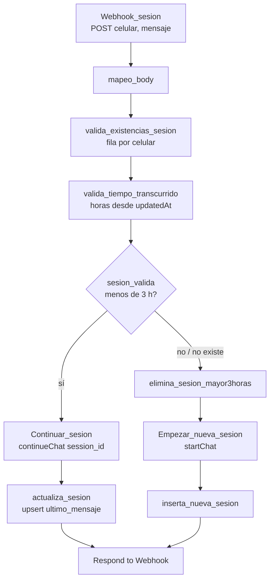

# Módulo 0 — Sesiones para canales externos (`Sesion_Usuario`)

Workflow de n8n que mantiene una conversación de Typebot por número de celular, para canales en los que Typebot no corre en el navegador del socio (WhatsApp u otro canal de mensajería). El canal web **no lo usa**: el widget de Typebot maneja su propia sesión.

También contiene el **manejador de errores** de todos los workflows del bot.

| | |
|---|---|
| n8n | Workflow `0.Sesion_Usuario` (ID `F5TPSiSS9JK7v3pz`) |
| Typebot | Nodo comunitario `n8n-nodes-typebot` (`startChat` / `continueChat`), bot publicado `botcc12345` |
| Almacenamiento | Data Table de n8n `historial_sesiones_typebot` |
| Webhook | `sesion_usuario` (POST) |
| Estado | Preparado para WhatsApp. Corregido (H-34), falta la prueba por webhook |

## 0.1 Mensaje entrante



**Request**

```json
{ "celular": "2245000000", "mensaje": "hola" }
```

| Paso | Detalle |
|---|---|
| `valida_tiempo_transcurrido` | Busca la fila del celular. La sesión es válida si `updatedAt` tiene menos de 3 horas |
| `Continuar_sesion` | `continueChat` con el `session_id` guardado y el **mensaje recién recibido** |
| `Empezar_nueva_sesion` | `startChat` del bot `botcc12345` con el mensaje como primer input. Guarda el `sessionId` devuelto |

**Columnas de `historial_sesiones_typebot`:** `celular`, `session_id`, `ultimo_mensaje`, `tiempo_transcurrido` (horas), más `createdAt` y `updatedAt` automáticas.

**Corregido en H-34 (03-11-2026):**

- `Continuar_sesion` enviaba como `sessionId` el texto literal `'$json.session_id'`. Typebot no encontraba la sesión y todas las conversaciones fallaban o se mezclaban. Ahora toma el `session_id` de la fila.
- Enviaba el **mensaje anterior** (`ultimo_mensaje` guardado) en vez del que acababa de llegar. Ahora usa `mapeo_body.mensaje`.

## 0.2 Limpieza programada

Cada 15 minutos (`Comprobacion - 15 minutos`): lee todas las filas, calcula `tiempo_transcurrido` y borra las que pasan de 3 horas.

Esta limpieza mide desde `createdAt` y no desde `updatedAt`, porque el propio cron actualiza la fila (`update_tiempo_transcurrido`) y eso mueve `updatedAt`. La consecuencia es que **una conversación activa se corta a las 3 horas de haber empezado**, aunque el socio haya escrito hace un minuto. Para corregirlo, conviene agregar una columna `ultimo_mensaje_at`, escribirla solo en `actualiza_sesion` e `inserta_nueva_sesion`, y medir las dos validaciones desde ella.

## 0.3 Manejador de errores

`manejo_errores_globales` (*Error Trigger*) → `informacion_falla_nodo` → `Envio_Mail_Error`. Los seis workflows (0 a 5) tienen configurado `errorWorkflow = F5TPSiSS9JK7v3pz`, así que cualquier ejecución fallida —por ejemplo, un dato rechazado por un `Validar_Entrada_*`— envía un correo con el workflow, el nodo y el error.

Si se reimporta el workflow 0 como **nuevo**, cambia su ID y hay que volver a elegirlo como *Error workflow* en la configuración de los demás.

## 0.4 Prueba

Con números de prueba, en este orden:

```bash
curl -X POST http://localhost:5678/webhook/sesion_usuario -H "Content-Type: application/json" -d '{"celular":"2245000001","mensaje":"hola"}'
curl -X POST http://localhost:5678/webhook/sesion_usuario -H "Content-Type: application/json" -d '{"celular":"2245000002","mensaje":"hola"}'
curl -X POST http://localhost:5678/webhook/sesion_usuario -H "Content-Type: application/json" -d '{"celular":"2245000001","mensaje":"1"}'
```

Resultado esperado: dos filas con `session_id` distintos; en la tercera ejecución, `Continuar_sesion` usa el `session_id` de `2245000001` y `ultimo_mensaje` queda en `"1"`.

## 0.5 Preguntas abiertas (H-34)

1. *Respond to Webhook* devuelve la fila de la Data Table, no los mensajes que respondió Typebot. Para WhatsApp, el canal necesita los mensajes del bot (y los botones) para reenviarlos. Hay que definir qué recibe quien llama.
2. Unificar la medición del tiempo con una columna `ultimo_mensaje_at` (sección 0.2).
3. `Envio_Mail_Error` envía a una casilla personal. Antes de producción, cambiarla por una del área de sistemas.
4. Confirmar que `botcc12345` es el `publicId` del bot publicado actual.
