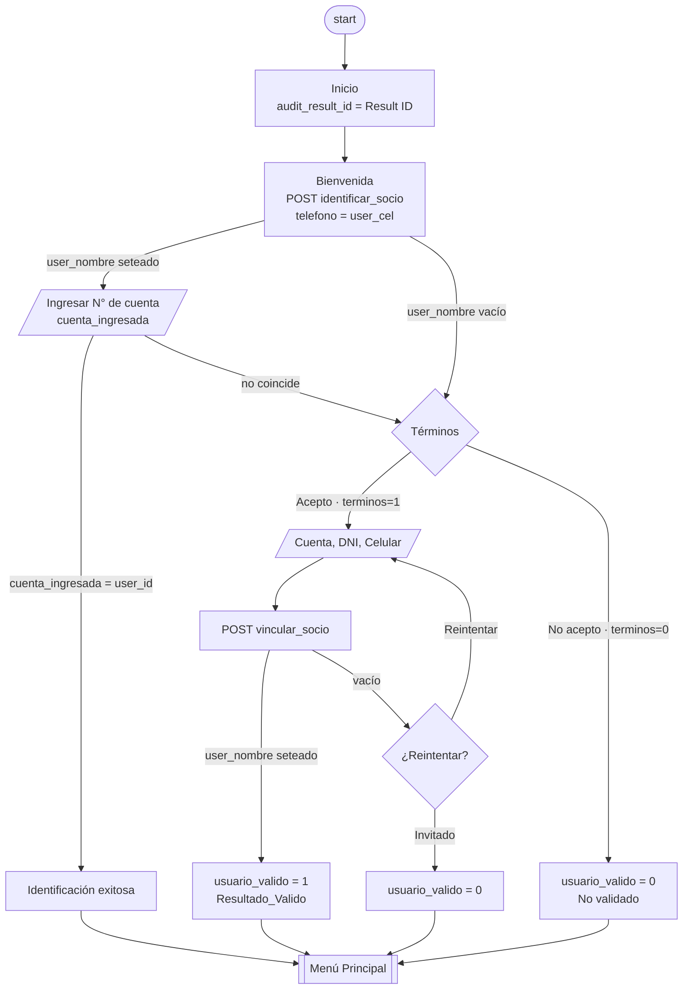
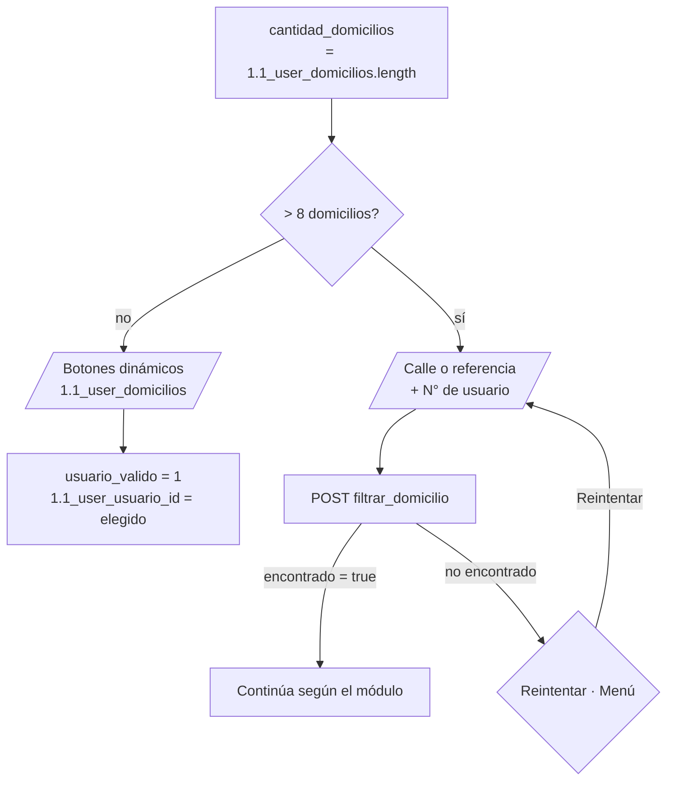
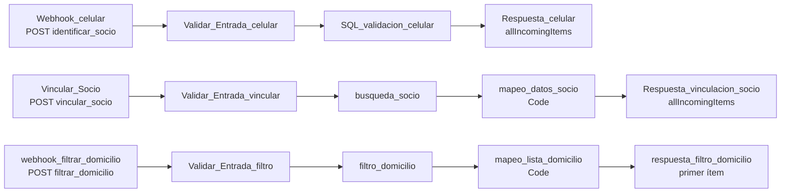

# Módulo 1 — Validación del socio

Identifica a quién está hablando y define si accede como **socio validado** (`usuario_valido = 1`) o como **invitado** (`usuario_valido = 0`). Incluye además la **selección de domicilio** que usan Deuda por suministro y Reclamos.

| | |
|---|---|
| Typebot | Grupos `Inicio`, `Bienvenida y Verificacion`, `Informacion y Terminos`, `Validación de usuario`, `¿Reintentar?`, `Usuario Valido`, `Usuario Invitado`, cadena `cantidad_domicilios` → `domicilio_filtro` |
| n8n | Workflow `1.Validaciones_Socio` (activo) |
| Base de datos | SQL Server — tablas `USUENER`, `USUINTE`, `USUAGUA` |
| Webhooks | `identificar_socio`, `vincular_socio`, `filtrar_domicilio` |

## 1.1 Flujo de identificación

Hay dos caminos. Primero se intenta reconocer al socio por su número de celular; si falla, se le piden cuenta, DNI y celular.



### Camino A — reconocimiento por celular

1. `Inicio` guarda el ID del resultado de Typebot en `audit_result_id` (se usa en auditoría).
2. `Bienvenida y Verificacion` comprueba primero si `user_cel` está vacío: si lo está, salta directo al Camino B sin llamar a n8n (H-02). Si tiene valor, llama a `identificar_socio` con `{"telefono": "{{user_cel}}"}` y mapea `data[0].nombre → user_nombre` y `data[0].Socio → user_id` (H-05).
3. Si `user_nombre` tiene valor, muestra *"Detectamos que este número pertenece a {{user_nombre}}"* y pide el número de cuenta (`cuenta_ingresada`).
4. Si `cuenta_ingresada = user_id`, muestra *Identificación Exitosa* y va al menú principal.
5. Si `user_nombre` está vacío o la cuenta no coincide, pasa al Camino B.

> **Estado: diferido hasta la migración a WhatsApp.** Ahí el canal va a entregar el número del socio en `user_cel`. En la versión web, `user_cel` llega vacío y el socio pasa siempre al Camino B. H-02, H-04 y H-05 ya están corregidos; falta H-06 (el Camino A no carga domicilios, medidores ni código de usuario).

### Camino B — validación por datos

1. `Informacion y Terminos` explica qué datos se piden y ofrece aceptar (`terminos = 1`) o seguir como invitado (`terminos = 0`).
2. `Validación de usuario` pide, en este orden, `user_id` (N° de cuenta), `user_dni` y `user_cel`.
3. Vacía `user_nombre` y `1.1_validacion_ok` y llama a `vincular_socio`. Mapea de `data[0]`: `user_nombre`, `user_domicilios_lista[].label → 1.1_user_domicilios`, `medidor_energia`, `medidor_agua`, `user_codigo → 1.1_nro_usuario`, `user_email → 1.1_user_email` (H-10) y `valido → 1.1_validacion_ok`.
4. Si `1.1_validacion_ok = true` → `usuario_valido = 1` → `Resultado_Valido` (resumen de datos) → menú (H-04). Si n8n rechaza el dato (por ejemplo, letras en el DNI), la variable queda vacía y el socio va a `¿Reintentar?`.
5. Si no → `¿Reintentar?`: volver a ingresar los datos o continuar como invitado.

### Efecto de `usuario_valido` en los menús

Las opciones de socio tienen *display condition* `usuario_valido = 1`, así que el invitado (`0`) no las ve.

| Menú | Opciones solo para socio (`= 1`) | Opciones solo para invitado (`= 0`) |
|---|---|---|
| `Menu Principal` | Consultar deuda total, Descargar mi factura, Hacer un reclamo, Ver mis suministros, Declarar pagos, Gestión de mi Internet | — |
| `Acceder a mi factura` | Acceder a mis Facturas (enlace con datos) | Acceder a mis Facturas // Se solicitarán datos |
| `Módulo de Internet.` | Mis planes y packs contratados | — |
| `Modulo Tramites, Subsidios y Tarifas.` | ¿Qué subsidio energético poseo? | — |

El resto de las opciones (operario, información, planes, horarios, métodos de pago) se muestra a los dos.

## 1.2 Selección de domicilio

Se ejecuta al entrar en **Ver Deuda por Suministros** y en **Hacer un reclamo**. Fija el domicilio de trabajo en `1.1_user_usuario_id`.



| Origen | Destino al terminar | Grupo de entrada |
|---|---|---|
| Suministros → Ver Deuda por Suministros | `Detalle.` (deuda por servicio) | `cantidad_domicilios` (`lxwh35…`) |
| Menú → Hacer un reclamo | `Módulo de Reclamos.` | `cantidad_domicilios` (`qfea09…`) |

El límite de 8 evita mostrar demasiados botones. Con más de 8 domicilios se pide una búsqueda por texto y el **número de usuario** (código del suministro) de la factura.

## 1.3 Workflow n8n `1.Validaciones_Socio`

Tres webhooks independientes, todos con `responseMode: responseNode`. Cada uno pasa primero por un nodo `Validar_Entrada_*` (H-01): los campos numéricos deben quedar solo con dígitos (se quitan espacios, puntos, guiones, paréntesis y `+`) y los de texto se recortan a 200 caracteres con las comillas escapadas. Si un dato no cumple, el nodo lanza un error y el webhook responde 500.



### Webhook `identificar_socio`

**Request**

```json
{ "telefono": "<celular>" }
```

**Validación** (`Validar_Entrada_celular`): `telefono` debe tener entre 10 y 15 dígitos. Un teléfono vacío o corto ya no puede devolver el padrón (H-02).

**Consulta** (`SQL_validacion_celular`): busca el celular en los tres padrones, solo suministros activos, comparando los **últimos 10 dígitos** del número guardado (sin espacios, guiones, paréntesis ni `+`) con los últimos 10 del recibido. Así coinciden `2245000000`, `(2245) 00-0000` y `5492245000000`.

```sql
SELECT 'Energía' AS servicio, Codigo, Socio, nombre, dni, domicilio, telefonocel
FROM USUENER
WHERE Activo = 1
  AND RIGHT(REPLACE(REPLACE(REPLACE(REPLACE(REPLACE(telefonocel,' ',''),'-',''),'(',''),')',''),'+',''), 10)
      = RIGHT('{{ $json.body.telefono }}', 10)
UNION ALL
-- ídem USUINTE ('Internet') y USUAGUA ('Agua')
ORDER BY Socio ASC;
```

Si el número está guardado con el `15` (por ejemplo `2245 15 000000`), los últimos 10 dígitos no coinciden. Conviene normalizar `telefonocel` en SIACCOP antes de habilitar WhatsApp.

**Response:** todas las filas encontradas, como array.

```json
[ { "servicio": "Energía", "Codigo": 0, "Socio": 0, "nombre": "", "dni": "", "domicilio": "", "telefonocel": "" } ]
```

### Webhook `vincular_socio`

**Request** (lo que envía Typebot)

```json
{ "cuenta": "", "dni": "", "usuario": "", "telefono": "", "email": "", "med_ener": "", "med_agua": "" }
```

n8n usa **solo** `cuenta` y `dni`, validados como numéricos. El resto de los campos llega vacío (Typebot todavía no los cargó) y se ignora. El nombre del webhook sugiere que guarda una vinculación, pero no escribe nada en la base.

**Consulta** (`busqueda_socio`): domicilios activos del par cuenta + DNI en los tres servicios.

```sql
SELECT DISTINCT Codigo, Socio, nombre, dni, email, medidor, tipo_servicio,
       UPPER(TRIM(domicilio)) AS domicilio
FROM (
    SELECT Codigo, Socio, nombre, dni, email, medidor, 'energia' AS tipo_servicio, domicilio
    FROM USUENER WHERE Socio = '{{ $json.body.cuenta }}' AND dni = '{{ $json.body.dni }}' AND Activo = 1
    UNION
    SELECT Codigo, Socio, nombre, dni, email, NULL, 'internet', domicilio
    FROM USUINTE WHERE Socio = '{{ $json.body.cuenta }}' AND dni = '{{ $json.body.dni }}' AND Activo = 1
    UNION
    SELECT Codigo, Socio, nombre, dni, email, medidor, 'agua', domicilio
    FROM USUAGUA WHERE Socio = '{{ $json.body.cuenta }}' AND dni = '{{ $json.body.dni }}' AND Activo = 1
) AS ListaDomicilios
WHERE domicilio IS NOT NULL AND TRIM(domicilio) <> ''
ORDER BY domicilio ASC;
```

**Transformación** (`mapeo_datos_socio`):

1. Sin filas → `[{ "valido": false }]`.
2. Toma el primer `nombre` y el primer `email` no vacíos.
3. Agrupa por domicilio normalizado (`TRIM` + mayúsculas) y junta los servicios de cada uno.
4. Arma la etiqueta del botón: `DOMICILIO (ENERGIA, AGUA, INTERNET)`.
5. `user_codigo`: prioriza el `Codigo` de internet; si no existe, el primero disponible.
6. `medidor_energia` / `medidor_agua`: el primero de cada servicio. Son solo un valor de respaldo: al registrar un reclamo, n8n vuelve a buscar el medidor del domicilio elegido (H-08, ver módulo 4).

**Response**

```json
[{
  "valido": true,
  "user_nombre": "",
  "user_email": "",
  "user_codigo": 0,
  "user_domicilios": ["CALLE 123 (ENERGIA, AGUA)"],
  "user_domicilios_lista": [{ "label": "CALLE 123 (ENERGIA, AGUA)", "value": "CALLE 123", "domicilio": "CALLE 123", "codigo": 0 }],
  "cantidad_domicilios": 1,
  "medidor_energia": "",
  "medidor_agua": ""
}]
```

### Webhook `filtrar_domicilio`

**Request**

```json
{ "cuenta": "", "codigo": "", "dni": "", "domicilio_buscado": "" }
```

**Validación** (`Validar_Entrada_filtro`): `cuenta`, `dni` y `codigo` numéricos; `domicilio_buscado` escapado.

**Consulta** (`filtro_domicilio`): igual a `busqueda_socio`, más `codigo = '{{codigo}}'` y `UPPER(domicilio) LIKE UPPER('%{{domicilio_buscado}}%')`. Acá el `LIKE` es intencional: el socio escribe parte de la calle. La etiqueta del resultado se arma como `DOMICILIO (SERVICIOS)`.

**Response** (un objeto, no un array):

```json
{ "encontrado": true, "user_domicilios": ["..."], "user_domicilios_lista": [{ "label": "...", "value": "...", "domicilio": "..." }], "cantidad_resultados": 1 }
```

Typebot toma solo `user_domicilios_lista[0].domicilio`: si la búsqueda coincide con varios domicilios, se queda con el primero sin avisar.

## 1.4 Variables

| Variable | Origen | Uso |
|---|---|---|
| `audit_result_id` | Evento start (Result ID) | Auditoría |
| `user_cel` | Canal (Camino A, futuro) / input en Camino B | Búsqueda por celular; se normaliza a `+549…` en `6.12_cel_chatwoot` para Chatwoot |
| `user_id` | `identificar_socio` (`data.Socio`) o input | N° de cuenta del socio. Clave de casi todos los webhooks |
| `user_dni` | Input (Camino B) | `vincular_socio`, `filtrar_domicilio`, factura |
| `user_nombre` | `identificar_socio` o `vincular_socio` | Saludos, reclamos y Chatwoot. No lo pisa ningún otro webhook (H-23) |
| `1.1_validacion_ok` | `vincular_socio` (`valido`) | Condición de validación (H-04) |
| `cuenta_ingresada` | Input (Camino A) | Comparación con `user_id` |
| `terminos` | Botón (1/0) | Bifurca validación o invitado |
| `usuario_valido` | Set variable (1/0) | Decide la ruta de Chatwoot |
| `1.1_user_domicilios` | `vincular_socio` / `filtrar_domicilio` | Lista de botones de domicilio |
| `1.1_user_usuario_id` | Botón dinámico | Domicilio elegido (se envía como `domicilio`) |
| `1.1_nro_usuario` | `vincular_socio` (`user_codigo`) o input | Código de usuario del suministro |
| `1.1_medidor_energia` / `1.1_medidor_agua` | `vincular_socio` | Reclamos |
| `1.1_busqueda_domicilio` | Input y luego `data.encontrado` | Se reutiliza para dos cosas distintas |
| `1.1_cantidad_domicilios` | `.length` de la lista | Umbral de 8 |
| `1.1_user_email` | `vincular_socio` (`user_email`, H-10) | Chatwoot |

## 1.5 Hallazgos del módulo

| ID | Estado |
|---|---|
| H-01 Inyección SQL | ✅ Validadores en los tres webhooks |
| H-02 Celular vacío devolvía el padrón | ✅ Typebot no llama sin celular; n8n exige 10 dígitos |
| H-03 Webhooks sin autenticación | Depende del despliegue |
| H-04 Validación por `user_nombre` | ✅ Ahora por `1.1_validacion_ok` |
| H-05 Mapeo `data` vs `data[0]` | ✅ |
| H-06 Sesión incompleta en Camino A | Diferido hasta WhatsApp |
| H-08 Medidor no ligado al domicilio | ✅ Se resuelve en el registro del reclamo |
| H-09 Cadena de domicilio triplicada | ✅ Queda una cadena por rama |
| H-10 Email nunca asignado | ✅ |

Detalle en [hallazgos.md](../hallazgos.md).
