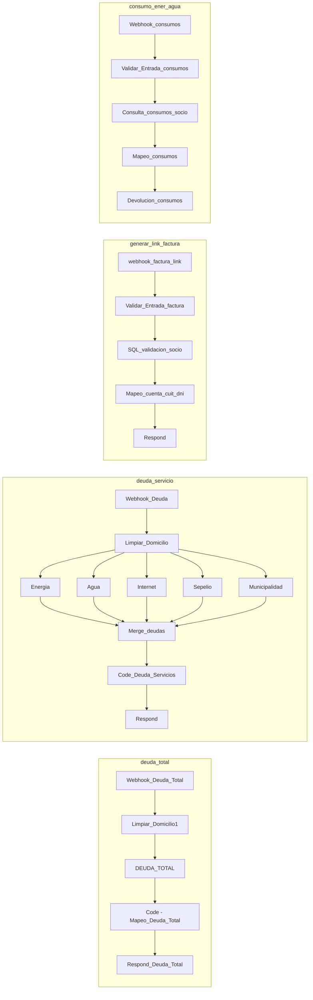

# Módulo 2 — Deuda, facturación y consumos

Muestra la deuda del socio (total o por domicilio), genera el enlace al portal de comprobantes y muestra los consumos de energía y agua.

| | |
|---|---|
| Typebot | `HTTP - Deuda Total`, `Detalle.` y la cadena `¿Deuda …?`, `HTTP - ComprobantesCuecca`, `HTTP - Consumos` |
| n8n | Workflow `2.consultar_deuda` (activo) |
| Base de datos | SQL Server SIACCOP — `DEUDA`, `DEUDA_DET`, `ITEMS`, `ESTADOS`, `USUENER`, `USUAGUA`, `USUINTE` |
| Webhooks | `deuda_total`, `deuda_servicio`, `generar_link_factura`, `consumo_ener_agua`. `desglose_deuda` está desactivado (H-25) |

## 2.1 Workflow n8n



### Nodo común `Limpiar_Domicilio`

Lo usan `deuda_total`, `deuda_servicio` y, en el módulo de reclamos, `usuario_activo` y `limite_reclamos`. Hace cuatro cosas:

1. Lee el body. Si no es un JSON válido, extrae `socio`, `codigo` y `domicilio` con expresiones regulares. Esto existe porque Typebot arma el body reemplazando texto y puede generar JSON inválido (H-11).
2. Corta el domicilio en el primer `(` para sacar la etiqueta de servicios: `CALLE 123 (ENERGIA, AGUA)` queda `CALLE 123`.
3. Valida `socio` (solo dígitos, hasta 15) y escapa el domicilio: duplica `'` y, en la copia que usa MySQL (`limite_reclamos`), también `\` (H-01). Si `socio` no es numérico, lanza un error y el webhook responde 500.
4. Devuelve `{ socio, domicilio_limpio }` con el domicilio en mayúsculas.

## 2.2 Deuda total — `deuda_total`

Se usa desde **Menú → Consultar deuda total**. Muestra toda la deuda del socio agrupada por período, sin filtrar por domicilio.

**Request** (Typebot)

```json
{ "socio": "{{user_id}}", "codigo": "{{1.1_nro_usuario}}", "domicilio": "{{1.1_user_usuario_id}}" }
```

Solo se usa `socio`. `codigo` y `domicilio` se ignoran.

**Consulta** `DEUDA_TOTAL`: `UNION ALL` de cinco bloques sobre `DEUDA`.

| Bloque | Criterio | Monto |
|---|---|---|
| Energía | `JOIN USUENER` por socio y código, `Servicio = 'Energia'` | `Total - Imputado` |
| Agua | `JOIN USUAGUA`, `Servicio = 'Agua'` | `Total - Imputado` |
| Internet | `JOIN USUINTE`, `Servicio = 'Internet'` | `Total - Imputado` |
| Sepelio aparte | Comprobantes con ítem 101 y `Servicio` distinto de Energía/Agua/Internet, cualquier prefijo salvo 99 (en la práctica, prefijo 34) | `Total - Imputado`. El sepelio que viene dentro de la factura de agua o energía ya está en ese bloque y no se suma de nuevo (H-15) |
| Municipalidad | `Prefijo = 99` | `Total - Imputado` |

Todos los bloques filtran `Total <> Imputado` (saldo pendiente), sin restricción de año (el filtro `Anio = 2026` se quitó el 02-11-2026, H-14).

La fecha de vencimiento se guarda como entero y se convierte así:

```sql
CONVERT(VARCHAR(10), DATEADD(day, CAST(d.FechaVencimiento AS INT) - 4, CAST('1801-01-01' AS DATE)), 103)
```

Fórmula validada contra facturas reales.

Todos los nodos SQL tienen *Always Output Data*: si no hay filas, el flujo sigue igual y responde (H-16).

**Transformación** `Code - Mapeo_Deuda_Total`:

- Sin deuda (o ante un error interno) devuelve `tiene_deuda: false` y `monto_total_formateado: null`, para que Typebot tome el camino "sin deuda" (H-16).
- Suma todo en `monto_total_general` y lo formatea en `es-AR` como `monto_total_formateado`.
- Agrupa por período `Mes/Año` y lista cada concepto: `💡 Energia (DOMICILIO) - Mes 9/2026: $X`.
- Marca cada ítem como `🔴 VENCIDO` o `🟢 A VENCER` comparando el vencimiento con la fecha actual.
- También arma bloques por servicio (`detalle_energia`, etc.), que Typebot no usa en este camino.

**Response** (objeto)

```json
{ "tiene_deuda": true, "monto_total_general": 0, "monto_total_formateado": "$0,00", "detalle_por_periodo": "...",
  "monto_energia": 0, "detalle_energia": "...", "...": "idem agua, internet, sepelio, municipalidad" }
```

**En Typebot:** mapea `monto_total_formateado → monto_total` y `detalle_por_periodo → detalle_total`. Si `monto_total` tiene valor, muestra el estado de cuenta. Si no, muestra *"No posee deudas registradas"* y ofrece volver a Facturación o al menú (H-16).

## 2.3 Deuda por suministro — `deuda_servicio`

Se usa desde **Ver mis suministros → Ver Deuda por Suministros**, después de elegir un domicilio (ver módulo 1.2).

**Request**: igual a `deuda_total`. Acá sí se usa `domicilio`.

**Consultas** (cinco nodos en paralelo):

| Nodo | Filtro de domicilio | Particularidad |
|---|---|---|
| `Deuda_Servicio Energia` | `UPPER(TRIM(ue.Domicilio)) = domicilio_limpio` | — |
| `Deuda_Servicio_Agua` | Igualdad sobre `ua.Domicilio` | — |
| `Deuda_Servicio_Internet` | Igualdad sobre `ui.Domicilio` | — |
| `Deuda_Servicio_Sepelio` | **Ninguno** | Solo el sepelio aparte (ítem 101, servicio distinto de energía/agua/internet, prefijo distinto de 99). El sepelio incluido en la factura de agua o energía ya está en ese bloque y no se repite (H-15) |
| `Deuda_Servicio_Municipalidad` | **Ninguno** | `Prefijo = 99`. Igual que el sepelio aparte, aparece en todos los domicilios del socio, porque esos comprobantes no se asocian a un suministro |

`Merge_deudas` (5 entradas) junta los resultados. `Code_Deuda_Servicios` lee cada nodo con `$('nombre').all()` y arma una tarjeta por factura (domicilio, usuario, período, importe, vencimiento y estado) y un total por servicio.

**Response**

```json
{ "tiene_deuda": true,
  "tiene_energia": true, "monto_energia": 0, "detalle_energia": "...",
  "tiene_agua": false, "monto_agua": null, "detalle_agua": null,
  "...": "idem internet, sepelio, municipalidad" }
```

**En Typebot:** el grupo `Detalle.` mapea los cinco montos y detalles. Después recorre `¿Deuda Energia?` → `¿Deuda Agua?` → … → `¿Deuda Municipalidad?` y muestra solo los bloques con monto. Al final ofrece métodos de pago, facturas digitales o volver.

## 2.4 Enlace a facturas — `generar_link_factura`

Se usa desde **Descargar mi factura → Acceder a mis Facturas** y desde el detalle de deuda.

**Request**

```json
{ "cuenta": "{{user_id}}", "dni": "{{user_dni}}" }
```

**Validación** `Validar_Entrada_factura`: `cuenta` y `dni` numéricos.

**Consulta** `SQL_validacion_socio`: busca el socio activo cuyo DNI **o** CUIT coincide con lo recibido y decide si se identifica por `cuit` o por `dni`.

**Transformación** `Mapeo_cuenta_cuit_dni`: arma

```
https://comprobantes.cuecca.com.ar/list.php?cuenta=<cuenta>&dni=<dni>   (o &cuit=<cuit>)
```

Si la consulta no devuelve nada, igual arma la URL con el DNI recibido (H-21, aceptado: los datos ya vienen validados en la sesión).

**Response:** `{ "url_factura": "..." }`. Typebot lo guarda en `2.2_link_factura` y abre la URL con un bloque *Redirect*. La opción *"Se solicitarán datos"* redirige al portal sin parámetros.

## 2.5 Consumos — `consumo_ener_agua`

Se usa desde **Ver mis suministros → Mis Consumos**.

**Request:** `{ "Socio": "{{user_id}}", "Codigo": "{{1.1_nro_usuario}}" }`. Solo se usa `Socio`.

**Validación** `Validar_Entrada_consumos`: `Socio` numérico.

**Consulta** `Consulta_consumos_socio`: une `USUENER` / `USUAGUA` con `ESTADOS` (lecturas) para los **tres meses cerrados anteriores al actual**. La ventana se calcula sobre `Anio * 100 + Mes`, así funciona también en el cambio de año (H-14):

```sql
AND (est.Anio * 100 + est.Mes)
    BETWEEN YEAR(DATEADD(MONTH, -3, GETDATE())) * 100 + MONTH(DATEADD(MONTH, -3, GETDATE()))
        AND YEAR(DATEADD(MONTH, -1, GETDATE())) * 100 + MONTH(DATEADD(MONTH, -1, GETDATE()))
```

Si las lecturas del mes anterior todavía no se cargaron en `ESTADOS`, se muestran solo dos meses.

**Transformación** `Mapeo_consumos`: agrupa por domicilio + medidor y arma un bloque de energía (kWh) y otro de agua (m³).

**Response**

```json
{ "encontrado": true, "nombre": "", "detalle_energia": "💡 *CONSUMOS DE ENERGÍA* ...", "detalle_agua": "💧 *CONSUMOS DE AGUA* ..." }
```

## 2.6 Endpoint desactivado — `desglose_deuda`

Devolvía gravado, no gravado, IVA y total de un período. Typebot no lo llama. El webhook y sus nodos están **desactivados** y se conservan por si se vuelve a necesitar (H-25).

## 2.7 Hallazgos del módulo

| ID | Estado |
|---|---|
| H-01 Inyección SQL | ✅ Validación en `Limpiar_Domicilio*`, factura y consumos |
| H-11 Body armado como texto | ✅ |
| H-14 Año y meses fijos | ✅ Deuda sin filtro de año; consumos con ventana móvil ([detalle](../correcciones/H-14-anio-fijo.md)) |
| H-15 Sepelio contado dos veces | ✅ |
| H-16 Casos "sin deuda" | ✅ |
| H-21 URL con DNI sin validar | Aceptado |
| H-25 Webhook sin uso | ✅ Desactivado |
| H-33 Comprobantes de prefijo 80 | **Abierto**: no aparecen en ninguna consulta |

Detalle en [hallazgos.md](../hallazgos.md).
