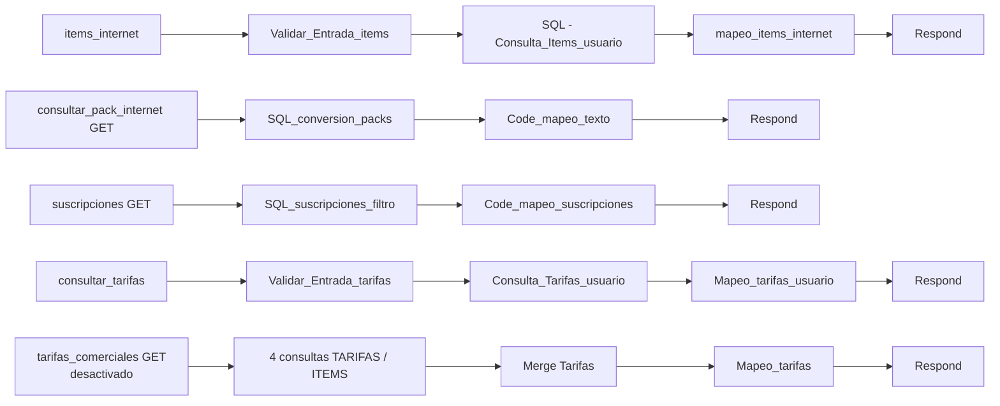

# Módulo 3 — Internet y tarifas

Muestra los servicios de internet contratados, el catálogo de planes y packs con precio, y la tarifa asignada al socio en cada servicio.

| | |
|---|---|
| Typebot | `Módulo de Internet.` (`http_items_internet`, `http_consulta_packs`, `http_consulta_suscripciones`), `HTTP_Busqueda_Tarifas` (dos copias) |
| n8n | Workflow `3.Modulo_Internet` (activo) |
| Base de datos | SQL Server SIACCOP — `USUINTE`, `USUITEM_I`, `TARIFAS`, `ITEMS`, `CATEG_DET`, `USUENER`, `USUAGUA` |
| Webhooks | `items_internet`, `consultar_pack_internet` (GET), `suscripciones` (GET), `consultar_tarifas`. `tarifas_comerciales` está desactivado (H-25) |

## 3.1 Workflow n8n



## 3.2 Servicios contratados — `items_internet`

**Request:** `{ "socio": "{{user_id}}", "domicilio": "{{1.1_nro_usuario}}" }`. Pese al nombre, `domicilio` lleva el **código de usuario** de internet que eligió `vincular_socio` (módulo 1). `Validar_Entrada_items` exige que los dos sean numéricos.

**Consulta**

```sql
SELECT ui.Nombre, ui.Codigo, ui.Tarifa, t.Descripcion AS TarifaDescripcion, uii.Descripcion AS PackDescripcion
FROM USUINTE ui
LEFT JOIN  USUITEM_I uii ON ui.Codigo = uii.UsuInternet   -- LEFT: el plan aparece aunque no tenga packs
INNER JOIN TARIFAS t     ON ui.Tarifa = t.Codigo
WHERE ui.Socio = '{{socio}}' AND ui.Codigo = '{{domicilio}}';
```

**Response**

| Caso | `tarifa_internet` | `servicios_internet` |
|---|---|---|
| Plan con packs | `🏷️ <tarifa>` | `  🔹 pack 1\n  🔹 pack 2` |
| Plan sin packs (por ejemplo, 500 MB) | `🏷️ <tarifa>` | `Sin packs adicionales` |
| Sin servicio de internet en ese código | `null` | `null` |

También devuelve `nombre_cliente` (en formato título), que Typebot ya no usa.

**En Typebot** (`http_items_internet`): vacía `3.1_tarifa_internet` y `3.1_descripcion_item_internet` antes de llamar, mapea solo esas dos variables (no pisa `user_nombre`) y bifurca por `3.1_tarifa_internet`:

- con valor → `tiene packs`: muestra nombre del socio, tarifa y packs.
- vacía → `no tiene packs`: *"No dispone de servicios contratados..."*.

Los dos caminos vuelven a `Módulo de Internet.` (H-23).

## 3.3 Catálogo de planes — `consultar_pack_internet`

Sin parámetros. Lee `ITEMS` con `Tarifa LIKE 'PACK%'`, excluye 25 MB y 50 MB, y calcula el precio por tarifa así:

```sql
SUM(ROUND(TRY_CAST(REPLACE(Formula, ',', '.') AS FLOAT) * 1.21, 0)) AS Precio_Total
```

Es decir: la columna `Formula` como número, más 21 % de IVA fijo en el código. `Code_mapeo_texto` descarta además `PACK1` y cualquier código que contenga `25` o `50`, y renombra los planes como *Plan 100 / 300 / 500 MB + TV Cable*.

**Response:** `{ "texto_tarifas": "📺 *PACKS INTERNET + TV CABLE* ..." }`. Typebot lo muestra tal cual.

## 3.4 Packs adicionales — `suscripciones`

Sin parámetros. Busca en `ITEMS` cinco descripciones fijas (`PACK FUTBOL PREMIUM`, `HBO MAX FULL`, `UNIVERSAL PLUS`, `PACK HOT GO`, `APP SENSA TV.`) con `Formula > 0` y aplica el mismo cálculo de IVA. Si en la base se cambia el nombre de un producto, desaparece del bot.

**Response:** `{ "texto_tarifas": "⭐ *PACKS ADICIONALES Y PREMIUM* ..." }`

## 3.5 Tarifa del socio — `consultar_tarifas`

Se usa desde **Suministros → Información sobre Tarifas** y desde **Trámites → ¿Qué subsidio energético poseo?**.

**Request:** `{ "numCuenta": "{{user_id}}" }`

**Consulta:** `UNION ALL` de `USUENER`, `USUINTE` y `USUAGUA` con `TARIFAS`, filtrando `Socio = '{{numCuenta}}'` (validado como numérico en `Validar_Entrada_tarifas`) y `Activo = 1`. **No filtra por domicilio:** si el socio tiene varios suministros activos del mismo servicio con tarifas distintas, queda el último que procesa el `forEach` (H-22, abierto).

**Response**

```json
{ "encontrado": true, "nombre": "", "codigo_tarifa_energia": "", "tarifa_energia": "",
  "codigo_tarifa_internet": "", "tarifa_internet": "", "codigo_tarifa_agua": "", "tarifa_agua": "" }
```

**En Typebot:** las dos copias de `Tarifas_Usuario` muestran **solo la tarifa de energía**, por requerimiento del área. n8n devuelve también internet y agua, y una de las copias los mapea en variables, pero no se muestran. Si más adelante se piden, alcanza con agregarlos al texto del bloque.

## 3.6 Endpoint desactivado — `tarifas_comerciales`

El webhook está desactivado (H-25). Arma un mensaje con los costos de conexión de energía, agua, internet y la cuota de sepelio. Typebot no lo llama (la opción *Información de Alta* usa textos fijos). Si se reactiva, hay que corregir antes `Mapeo_tarifas`: toma cada valor por posición (`energia[1]`, `agua[0]`, `internet[2]`), pero las consultas no tienen `ORDER BY`, así que un precio puede mostrarse con la etiqueta de otro (H-22).

## 3.7 Hallazgos del módulo

| ID | Estado |
|---|---|
| H-01 Inyección SQL | ✅ Validación en `items_internet` y `consultar_tarifas` |
| H-22 Tarifas sin domicilio y por posición | **Parcial**: `Activo = 1` y socio entre comillas; falta el filtro por domicilio |
| H-23 Catálogo en el código / socio sin packs | ✅ Caminos `tiene packs` / `no tiene packs`. El catálogo en código es una decisión de diseño: un pack nuevo se agrega a mano |
| H-25 Webhook sin uso | ✅ Desactivado |

Detalle en [hallazgos.md](../hallazgos.md).
