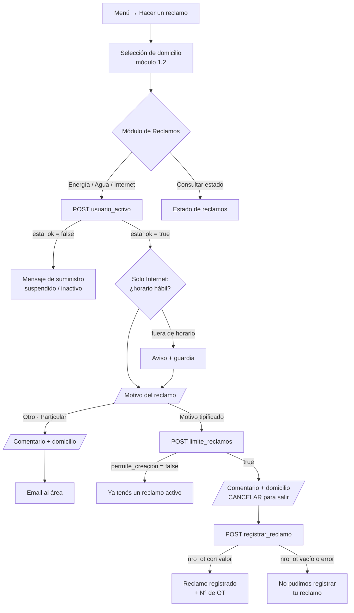
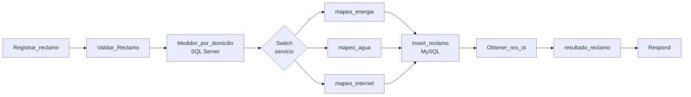

# Módulo 4 — Reclamos

Permite cargar reclamos técnicos de energía, agua e internet como órdenes de trabajo en SIGO, y consultar el estado de los reclamos. Los reclamos "particulares" no van a la base: se envían por email.

| | |
|---|---|
| Typebot | `Módulo de Reclamos.`, `HTTP - Verificacion Estado Usuario *`, `HTTP_Reclamo_Limite_*`, `Reclamo *`, `HTTP Reclamo*`, `Reclamo_Particular`, `Estado Reclamo Seleccion` |
| n8n | Workflow `4. Modulo_Reclamos` (activo) |
| Bases de datos | SQL Server SIACCOP (estado del suministro) · **MySQL SIGO** — `orden_trabajo`, `auxiliar_estado_trabajos`, `auxiliar_cierre_actividades` |
| Webhooks | `usuario_activo`, `limite_reclamos`, `registrar_reclamo`, `estado_reclamo`, `vincular_socio_reclamo` (desactivado) |

## 4.1 Flujo en Typebot



Para energía y agua, la verificación de horario aplica solo a la derivación al operador (módulo 6). Internet tiene su propio control de horario (L-V 8 a 19 h, sáb. 8 a 12 h): fuera de ese horario, avisa que conviene llamar a la guardia, pero deja cargar el reclamo igual.

| Servicio | Motivos ofrecidos (`4.4_reclamo_subtipo`) |
|---|---|
| Energía | Medición de voltaje · Cortes de luz constantes / suministro cortado · Otro (particular) |
| Agua | Alto consumo · Cañería tapada · Otro (particular) |
| Internet | Sin servicio de internet · Otro (particular) |

Escribir "cancelar" en el comentario o en el domicilio vuelve al menú sin registrar nada.

## 4.2 Estado del suministro — `usuario_activo`

**Request:** `{ "socio": "{{user_id}}", "domicilio": "{{1.1_user_usuario_id}}" }`

`Limpiar_Domicilio` valida `socio` y escapa el domicilio (ver módulo 2).

**Consulta** `reclamo_activo_suspendido`: para cada servicio (`USUENER`, `USUAGUA`, `USUINTE` con `USUESTADOS`), las filas del socio cuyo domicilio es **igual** a `domicilio_limpio` (`UPPER(TRIM(Domicilio)) = ...`). Antes era `LIKE '%...%'`, y `CALLE 12` coincidía también con `CALLE 123` (H-20).

**Regla:** el suministro está habilitado para reclamos solo si `Activo = 1` y `CodEstado = 2`.

| `CodEstado` | Mensaje |
|---|---|
| 2 y `Activo = 1` | 🟢 Activo y habilitado |
| 3 | 🚫 Suspendido |
| 4 o `Activo = 0` | 🔴 Inactivo |
| 1 | ⏳ En proceso de alta |

**Response**

```json
{ "permite_reclamo": true,
  "servicios": { "energia": { "codigo": 0, "activo": 1, "cod_estado": 2, "estado_descripcion": "", "causaBaja": null, "esta_ok": true, "mensaje_estado": "" } } }
```

Typebot lee `data.servicios.<servicio>.esta_ok`, `estado_descripcion`, `mensaje_estado` y `causaBaja` del servicio que corresponde a cada rama (H-18).

## 4.3 Límite de reclamos — `limite_reclamos`

Regla de negocio: **un solo reclamo abierto por socio, domicilio y tipo de servicio**.

**Request:** `{ "servicio": "Energia|Agua|Internet", "socio": "{{user_id}}", "domicilio": "{{1.1_user_usuario_id}}" }`

`Limpiar_Domicilio1` valida `socio` y escapa el domicilio para MySQL (`'` y `\`).

**Consulta** (MySQL SIGO):

```sql
SELECT ot_sector, ot_actividad, ot_tarea AS descripcion_reclamo
FROM orden_trabajo
WHERE ot_nro_socio = '{{socio}}'
  AND TRIM(SUBSTRING_INDEX(ot_domicilio, '(', 1)) = TRIM(SUBSTRING_INDEX('{{domicilio_limpio}}', '(', 1))
  AND tipo = 'RECLAMO'
  AND ot_cierre IN (1, 3);
```

`ot_cierre IN (1, 3)` es el mismo criterio de "abierto" que usa la lista de reclamos activos (H-20).

Un `Switch` por servicio (normaliza tildes en el subtipo, H-19) busca si alguna orden abierta coincide con el sector y la actividad del reclamo nuevo:

| Servicio | Sector / actividad que bloquea |
|---|---|
| Energía | 1 / 27 (voltaje y cortes), 1 / 21 (pilar) |
| Agua | 6 / 131 o 7 / 152 (cualquiera de los dos) |
| Internet | 2 / 248 |

**Response:** `{ "permite_creacion": true, ... }` o `{ "permite_creacion": false, "mensaje_respuesta": "⚠️ YA TENÉS UN RECLAMO ACTIVO ..." }`

## 4.4 Registro — `registrar_reclamo`

**Request**

```json
{ "servicio": "Energia", "subtipo": "", "comentario": "", "cuenta": "", "nombre": "",
  "domicilio": "{{1.1_user_usuario_id}}", "domicilio_particular": "", "medidor_energia": "", "medidor_agua": "" }
```

**Flujo n8n**



1. `Validar_Reclamo`: `cuenta` solo dígitos; domicilio cortado en el primer `(`, en mayúsculas y con `'` escapado (H-01).
2. `Medidor_por_domicilio`: busca en SIACCOP el medidor de energía y de agua **del domicilio elegido** (`Socio`, domicilio y `Activo = 1`). Si no encuentra, usa el que mandó Typebot (H-08).
3. `mapeo_*`: tipifica la orden (tabla siguiente) y escapa todos los textos para MySQL: `'` → `''` y `\` → `\\` (H-11).
4. `insert_reclamo` → `Obtener_nro_ot` (última OT de tipo `RECLAMO` de ese socio) → `resultado_reclamo` devuelve `{ "ok": true, "nro_ot": 1234 }`, o `{ "ok": false, "nro_ot": null }` si no encontró la OT.

**Tipificación** (código de los nodos `mapeo_*`):

| Servicio | Condición sobre `subtipo` | `ot_sector` | `ot_actividad` | Otros |
|---|---|---|---|---|
| Energía | contiene "voltaje" | 1 | 27 | `ot_tipo_tarea = 4`, `ot_zona_trabajo = 1` |
| Energía | contiene "pilar" | 1 | 21 | — |
| Energía | resto | 1 | 27 | — |
| Agua | contiene "caneria" o "cloacas" | 7 | 152 | El subtipo se normaliza sin tildes: "Cañería Tapada." coincide (H-19) |
| Agua | resto | 6 | 131 | — |
| Internet | siempre | 2 | 248 | — |

`ot_tarea` = `subtipo - Comentario Socio: <comentario> - Domicilio Socio: <domicilio_particular>`. La orden se crea con `ot_improcedente = 1`, `ot_ejecucion = 1`, `ot_cierre = 1`, `ot_trabajo = 2`.

**Inserción** (MySQL SIGO):

```sql
INSERT INTO orden_trabajo (ot_nro_ot, tipo, ot_sector, ot_actividad, ot_tipo_tarea, ot_zona_trabajo,
  ot_asociado, ot_nro_socio, ot_domicilio, ot_medidor, ot_tarea, ot_improcedente, ot_ejecucion, ot_cierre, ot_trabajo)
SELECT COALESCE(MAX(ot_nro_ot), 0) + 1, '{{tipo}}', {{ot_sector}}, ..., '{{ot_tarea}}', 1, 1, {{ot_cierre}}, {{ot_trabajo}}
FROM orden_trabajo;
```

El número de OT se calcula con `MAX() + 1` dentro del mismo `INSERT`: dos inserciones simultáneas podrían obtener el mismo número (H-13, riesgo aceptado por el volumen esperado). Los valores se siguen interpolando como texto, pero llegan escapados desde `mapeo_*`.

**En Typebot** (`HTTP Reclamo`, `HTTP Reclamo_Agua`, `HTTP Reclamo_Internet`):

1. Vacía `4.6_reclamo_ok` y `4.6_nro_ot`.
2. Llama al webhook. El body se arma con `JSON.stringify` en los campos de texto libre (`comentario`, `domicilio_particular`, `nombre`, `domicilio`), así un `"` no rompe el JSON (H-11).
3. Mapea `data.ok → 4.6_reclamo_ok` y `data.nro_ot → 4.6_nro_ot`.
4. Si `4.6_nro_ot` tiene valor → `Reclamo OK <servicio>`: detalle del reclamo con **N° de reclamo (OT)**. Si está vacío (insert fallido o error de n8n) → `Reclamo - Error`: *"No pudimos registrar tu reclamo"* (H-12). Los dos vuelven a `Módulo de Reclamos.`.

### Reclamo particular

"Otro (particular)" no pasa por n8n. Typebot envía un email (bloque *Email*, credencial SMTP de Typebot) a una dirección fija con nombre, cuenta, DNI, celular, domicilios, servicio, motivo, medidor y comentario (H-27).

## 4.5 Estado de reclamos — `estado_reclamo`

**Request:** `{ "nro_socio": "{{user_id}}", "tipo_reclamo": "1|2" }` (1 = activos, 2 = cerrados)

| Lista | Filtro en `orden_trabajo` |
|---|---|
| Activos | `tipo LIKE '%RECLAMO%' AND ot_ejecucion = 1 AND ot_cierre IN (1, 3)` |
| Cerrados | `tipo LIKE '%RECLAMO%' AND ot_ejecucion = 3 AND ot_cierre = 2` |

`Validar_Entrada_estado` exige `nro_socio` numérico, y las consultas lo usan entre comillas (H-01). El estado sale de `auxiliar_estado_trabajos` y el avance de `auxiliar_cierre_actividades`.

**Response**

```json
{ "tiene_reclamos": true,
  "reclamos": [ { "id": "123", "label": "Número de Tramite #123 - <tarea>", "estado": "", "avance": "" } ] }
```

**En Typebot:** los `label` se muestran como botones (lista dinámica `6.7_lista_reclamos`). Typebot guarda además `6.7_reclamos_ids`, `6.7_reclamos_estados` y `6.7_reclamos_avances`, y al elegir un reclamo toma el estado y el avance de la misma posición (H-17).

## 4.6 Webhook desactivado

`vincular_socio_reclamo` (marcado REMOVIDO) está desactivado. Validaba invitados para que pudieran cargar reclamos. Se conserva por si se vuelve a necesitar (H-25).

## 4.7 Hallazgos del módulo

| ID | Estado |
|---|---|
| H-01 / H-11 Inyección SQL y texto libre | ✅ |
| H-08 Medidor no ligado al domicilio | ✅ `Medidor_por_domicilio` |
| H-12 Éxito sin verificar | ✅ Respuesta `{ok, nro_ot}` y camino de error |
| H-13 N° de OT con `MAX()+1` | Riesgo aceptado |
| H-17 Estado del reclamo equivocado | ✅ |
| H-18 Mapeos de la rama Internet | ✅ |
| H-19 "Cañería" mal tipificada | ✅ |
| H-20 Criterios de "abierto" y búsqueda parcial | ✅ |
| H-27 Email a casilla personal | Cambiar a la institucional antes de producción |

Detalle en [hallazgos.md](../hallazgos.md).
