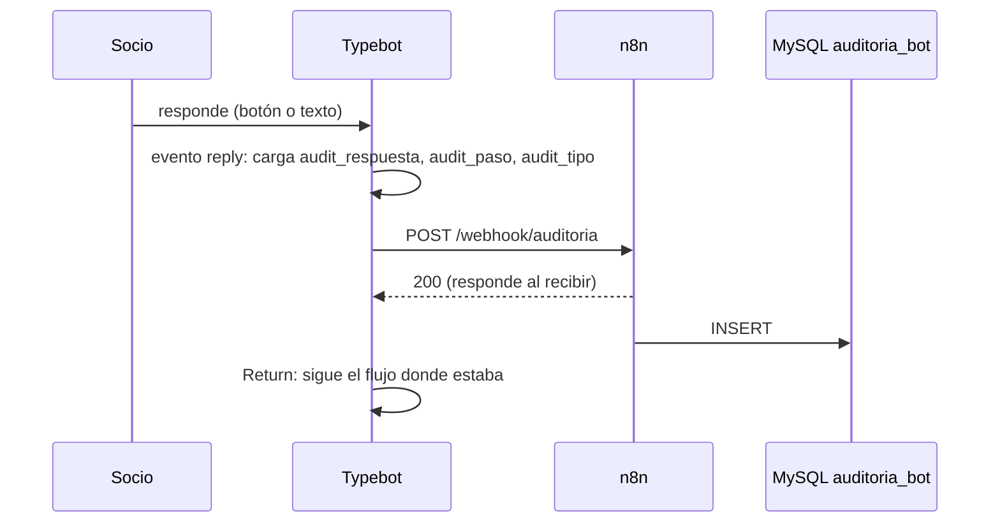

# Módulo 5 — Auditoría de conversaciones

Guarda en MySQL cada respuesta del socio, junto con una foto de las variables clave del bot en ese momento.

| | |
|---|---|
| Typebot | Evento `reply` → grupo `HTTP  - Auditoria` (con dos espacios) → `Return` |
| n8n | Workflow `5. Modulo_Auditoria` (activo) |
| Base de datos | MySQL `Bot_CC Auditoria` — tabla `auditoria_bot` |
| Webhook | `auditoria` |

## 5.1 Funcionamiento



1. Al iniciar, el evento `start` guarda el ID de resultado de Typebot en `audit_result_id`. Ese ID agrupa todas las filas de una conversación.
2. Con cada respuesta, el evento `reply` carga tres variables de sesión: el contenido, el nombre del input y el tipo de input. Se asume que van a `audit_respuesta`, `audit_paso` y `audit_tipo`; hay que confirmarlo en el editor.
3. `HTTP  - Auditoria` envía el registro y `Return` devuelve el control al bloque donde estaba el socio.

El webhook no tiene nodo *Respond*, así que n8n responde apenas recibe el pedido y la auditoría no demora la conversación.

## 5.2 Contrato

**Request**

```json
{
  "result_id": "{{audit_result_id}}",
  "socio_id": "{{user_id}}",
  "paso": "{{audit_paso}}",
  "tipo": "{{audit_tipo}}",
  "respuesta": "<texto o valor elegido>",
  "datos_bot": {
    "nombre": "", "monto_total": "", "detalle_total": "", "tiene_deuda": "",
    "monto_energia": "", "monto_agua": "", "monto_internet": "", "monto_sepelio": "", "monto_municipalidad": "",
    "link_factura": "", "reclamos": [], "estado_reclamo": "",
    "energia_estado": "", "agua_estado": "", "internet_estado": "", "reclamo_permitido": ""
  },
  "transcript": ""
}
```

Typebot arma `respuesta` y `datos_bot` con `JSON.stringify`, así que estos dos campos sí salen bien escapados (a diferencia de los otros webhooks, ver H-11).

## 5.3 Persistencia

Nodo `Insert - BDD Bot_cc_Auditoria`: operación *Insert* de n8n (consulta parametrizada, sin inyección SQL).

| Columna | Valor |
|---|---|
| `result_id` | `body.result_id` |
| `socio_id` | `body.socio_id` |
| `paso` | `body.paso` |
| `tipo` | `body.tipo` |
| `respuesta` | `body.respuesta` |
| `datos_bot` | `JSON.stringify(body.datos_bot)` |

`transcript` llega pero no se guarda; además, `audit_transcript` nunca se carga en Typebot.

## 5.4 Hallazgos del módulo

- **H-24 (abierto):** los datos personales se guardan sin política de retención. Falta definir cuánto tiempo se conservan y quién puede consultarlos.
- El grupo huérfano `HTTP - Auditoria` (con un espacio y el webhook vacío) ya no está en el flujo (H-09).
- Probado el 03-11-2026 con tres sesiones web simultáneas: cada una se registra con su `result_id` y no se mezclan.

Detalle en [hallazgos.md](../hallazgos.md).
