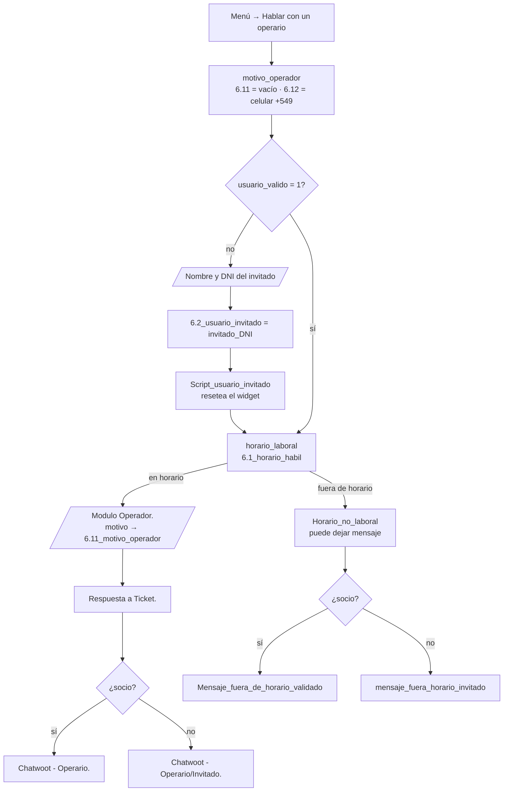

# Módulo 6 — Derivación a Chatwoot

Cuando el socio o el invitado pide hablar con una persona, Typebot abre el widget de Chatwoot con sus datos, una etiqueta según el motivo y atributos que el operador ve en la conversación.

| | |
|---|---|
| Typebot | `motivo_operador`, `Usuario_Valido_Operario`, `Usuario_invitado_operario`, `Script_usuario_invitado`, `horario_laboral`, `Verificacion_Horario`, `Modulo Operador.`, `Respuesta a Ticket.`, `Horario_no_laboral`, `chatwoot_tipo_usuario_horario`, `chatwoot_tipo_usuario_f.horario` y los cuatro grupos con bloque Chatwoot |
| n8n | No interviene |
| Chatwoot | Inbox de tipo *Website*. `baseUrl` y `websiteToken` en cada bloque Chatwoot |
| Corrección relacionada | [H-28](../correcciones/H-28-contexto-chatwoot.md) |

## 6.1 Flujo



Cada uno de los cuatro grupos finales tiene el bloque **Chatwoot** (abre el widget y carga el contacto) seguido de un bloque **Code** (etiqueta y atributos).

### Horario

`horario_laboral` calcula `6.1_horario_habil` con la hora de `America/Argentina/Buenos_Aires`:

| Día | Horario de atención |
|---|---|
| Lunes a viernes | 08:00 a 12:00 y 16:00 a 20:00 |
| Sábados | 08:00 a 12:00 |
| Domingos | Sin atención |

Los textos de `Horario de atención` y `Horario_no_laboral` muestran el mismo horario (H-35). Fuera de horario no se pide el motivo: el socio deja su mensaje y la conversación queda con la etiqueta `fuera_de_horario`.

Los reclamos de Internet usan otro `horario_laboral` (de 8 a 19 corrido, sábados de 8 a 12) que solo decide si se muestra el aviso de guardia (módulo 4).

## 6.2 Datos del contacto

| Campo de Chatwoot | Socio | Invitado |
|---|---|---|
| Identificador | `{{user_id}}` (N° de cuenta) | `{{6.2_usuario_invitado}}` = `invitado_<DNI>` (o `invitado_anonimo`) |
| Nombre | `{{user_nombre}}` | `{{6.3_user_nombre_invitado}}` |
| Email | `{{1.1_user_email}}` (de `vincular_socio`) | — |
| Teléfono | `{{6.12_cel_chatwoot}}` | — (no se pide celular) |

**Celular.** `motivo_operador` normaliza `user_cel` al formato E.164 que exige Chatwoot:

| Escrito por el socio | Enviado |
|---|---|
| `2245000000` | `+5492245000000` |
| `02245 15-000000` | `+5492245000000` |
| `+54 9 2245 000000` | `+5492245000000` |
| `011 15 1234-5678` | `+5491112345678` |
| `1512345678`, `0800…`, `12345` | vacío |

Acepta los prefijos `54`, `9`, `0` y el `15` después de un código de área de 2, 3 o 4 dígitos. Solo envía números con código de área argentino (`11`, o que empiece con `2` o `3`). Si no puede normalizarlo, no envía teléfono, porque un número inválido hace que Chatwoot rechace el contacto.

**Identificador del invitado.** Se arma con el DNI para que dos invitados distintos no compartan contacto (H-31). Antes de abrir el widget, `Script_usuario_invitado` ejecuta `$chatwoot.reset()` y borra las claves `cw_*` del navegador, así el invitado no hereda la conversación de un socio anterior en el mismo equipo.

## 6.3 Etiqueta y atributos

El bloque Code de los cuatro grupos es el mismo:

```js
const motivo    = String({{6.11_motivo_operador}} ?? "");
const enHorario = String({{6.1_horario_habil}} ?? "") === "true";
const esSocio   = String({{usuario_valido}} ?? "") === "1";
```

Las variables de Typebot **no van entre comillas**: Typebot las reemplaza por su valor como literal de JavaScript. Escribir `"{{variable}}"` deja el texto con comillas extra y la comparación nunca da verdadera (H-28, H-31).

| Botón de `Modulo Operador.` | Valor interno (`6.11_motivo_operador`) | Etiqueta | Motivo mostrado |
|---|---|---|---|
| 💰 Facturación y Convenios | `facturacion` | `caja_atencion` | Facturación y Convenios |
| 🛠️ Soporte Técnico Especializado | `soporte_tecnico` | `reclamo_tecnico_prioridad` | Soporte Técnico Especializado |
| 📝 Trámites y Cambio de Titularidad | `tramites` | `tramites_atencion` | Trámites y Cambio de Titularidad |
| 🌐 Planes y Contrataciones | `planes` | `planes_contrataciones` | Planes y Contrataciones |
| 💬 Otra Consulta | `otra` | `consulta_general` | Otra consulta |
| (fuera de horario) | vacío | `fuera_de_horario` | Sin motivo (mensaje fuera de horario) |

Se cargan en dos momentos:

| Cuándo | Qué | Método del SDK |
|---|---|---|
| Widget listo (`chatwoot:ready`) | Atributos del **contacto**: `tipo_usuario` (`socio` / `invitado`), `ultimo_motivo` y, para el invitado, `dni` | `setCustomAttributes` |
| Primer mensaje (`chatwoot:on-message`) | **Etiqueta** y atributo de la **conversación** `motivo_consulta` | `setLabel`, `setConversationCustomAttributes` |

La etiqueta espera al primer mensaje porque la conversación recién existe cuando el socio escribe.

## 6.4 Configuración en Chatwoot

1. **Etiquetas** (Configuración → Etiquetas): crear `caja_atencion`, `reclamo_tecnico_prioridad`, `tramites_atencion`, `planes_contrataciones`, `consulta_general` y `fuera_de_horario`. Si una etiqueta no existe, `setLabel` no hace nada y no avisa.
2. **Atributos personalizados** (Configuración → Atributos personalizados):
    - de contacto: `tipo_usuario`, `ultimo_motivo`, `dni` (texto);
    - de conversación: `motivo_consulta` (texto).
3. **Inbox:** el `websiteToken` del bloque Chatwoot es el del inbox *Website*. Si se recrea el inbox, hay que actualizarlo en los cuatro bloques.

## 6.5 Diagnóstico

| Síntoma | Qué revisar |
|---|---|
| Todas las conversaciones salen con `fuera_de_horario` | Variables entre comillas en el bloque Code (H-28) o `6.1_horario_habil` no calculado antes de la derivación |
| No aparece el teléfono | En el navegador, Inspeccionar → Red → pedido `set_user`. Si no trae `phone_number`, el número no se pudo normalizar. Si responde 422, otro contacto ya tiene ese número (Chatwoot no permite repetirlo) |
| No se envía `set_user` | El widget tenía guardado ese usuario de una sesión anterior. Probar en incógnito |
| La etiqueta no aparece | La etiqueta no existe en Chatwoot, o el socio todavía no escribió ningún mensaje |
| Dos invitados ven la misma conversación | El identificador no incluye el DNI o falta el reset del widget (H-31) |

## 6.6 Pendiente para WhatsApp

En el canal WhatsApp, Chatwoot es el punto de entrada y Typebot actúa como *agent bot*: el widget, `setUser` y el reset no aplican. La etiqueta y el motivo se tendrán que asignar con la API de Chatwoot al hacer el *handover* (ver [arquitectura objetivo](../04_arquitectura_e_integraciones.md#-2-arquitectura-objetivo-whatsapp)).

## 6.7 Hallazgos del módulo

| ID | Estado |
|---|---|
| H-10 Email nunca asignado | ✅ |
| H-28 Sin motivo ni etiquetas; DNI como teléfono | ✅ Verificado en Chatwoot |
| H-31 Invitados compartiendo contacto | ✅ |
| H-35 Horario inconsistente en los textos | ✅ |

Detalle en [hallazgos.md](../hallazgos.md).
